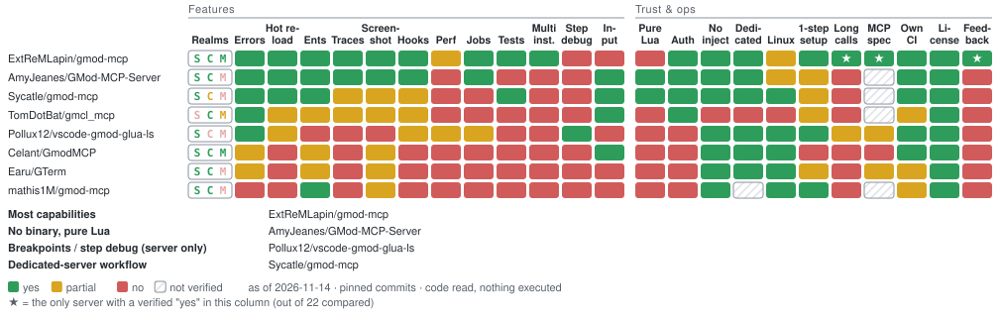
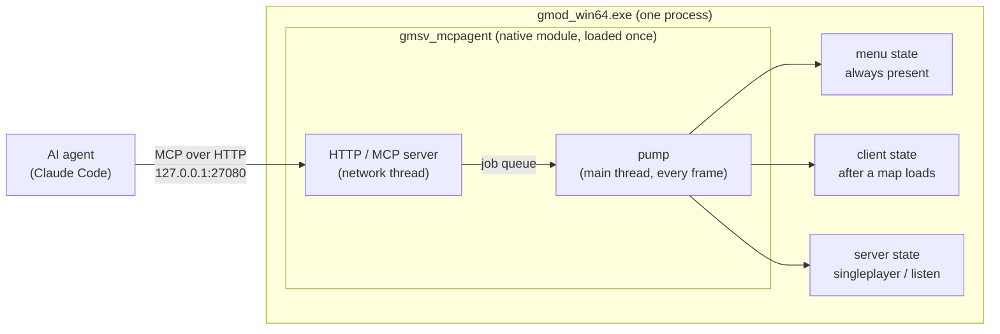
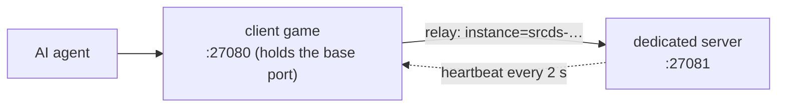

# gmod-mcp

[](https://github.com/ExtReMLapin/gmod-mcp/actions/workflows/build.yml)
[](https://github.com/ExtReMLapin/gmod-mcp/actions/workflows/build.yml)

---- 
##### The GMod MCP server that runs inside the game: Lua in every realm, maps, console, errors, screenshots, hook tracing, test clients and long-running jobs, straight from inside the game.
----

> [!TIP]
> ## Quick start (Claude Code, Windows)
>
> **1.** In Claude Code, run:
>
> ```
> /plugin marketplace add ExtReMLapin/gmod-mcp
> /plugin install gmod-mcp@gmod-mcp
> ```
>
> **2.** Restart Claude Code.
>
> **3.** Ask Claude: **`set up gmod-mcp`**
>
> That's it. Claude installs the module in your game (it asks first) and starts Garry's Mod with `-mcp`.
>
> **4. Turn on updates (recommended):** `/plugin` → **Marketplaces** → `gmod-mcp` → **Enable auto-update**. Claude Code
> keeps auto-update off for marketplaces other than Anthropic's, and no command can turn it on for you. See
> [Updates](#updates).
>
> Other MCP clients, Linux or a dedicated server: see [Install](#install).

**An MCP server that lives inside Garry's Mod.** Drop one native module into your game and an AI coding agent
(Claude Code or any MCP client) can run Lua in the menu, client and server realms, load maps, read the console and
errors, inspect and edit the world, take screenshots, trace hooks and look up the documentation — on your own machine.

- **Self-contained**: one DLL and one small Lua file in the game. With Claude Code, the plugin installs them and adds a
  small bridge that Claude Code starts by itself. No Python, no Node, nothing to run yourself.
- **Local only**: listens on `127.0.0.1` with a bearer token, refuses pages from other sites, inactive unless the game
  is started with `-mcp`.
- **Safe by default**: never touches the client realm while you are connected to someone else's server.

## Contents

- [Install](#install)
  - [1. Garry's Mod side (drag and drop)](#1-garrys-mod-side-drag-and-drop)
  - [2. MCP client side](#2-mcp-client-side)
  - [Dedicated server](#dedicated-server)
  - [Claude Code plugin](#claude-code-plugin)
- [Updates](#updates)
- [Feedback from agents](#feedback-from-agents)
- [Tools](#tools)
  - [Long-running Lua jobs](#long-running-lua-jobs)
  - [Testing a branch: the mounted Lua folder](#testing-a-branch-the-mounted-lua-folder)
- [How it works](#how-it-works)
- [Several games at once](#several-games-at-once)
- [Configuration](#configuration)
- [Security](#security)
- [What gets modified in your game folder](#what-gets-modified-in-your-game-folder)
- [Uninstall](#uninstall)
- [Limitations](#limitations)
- [Building from source](#building-from-source)

## Install

You need Garry's Mod with the **64-bit** binaries (`gmod_win64.exe`, the default on current Steam builds).

**With Claude Code**: the Quick start at the top of this page. The plugin brings the module and
connects Claude Code by itself; its skill copies the two files into the game (after asking you) and starts the game with
`-mcp`. Claude Code stays connected while the game is closed: the tools say so,
Claude starts the game again instead of giving up, and they work again as soon as it is up, no reconnection needed.
Updates: see [Updates](#updates).

Or by hand (other MCP clients, or without the plugin), in two steps:

### 1. Garry's Mod side (drag and drop)

1. Download `gmod-mcp-win64.zip` from the [latest release](../../releases/latest).
2. Open it and drag its `garrysmod` folder onto your game folder
   (`…\steamapps\common\GarrysMod`, the one that already contains a `garrysmod` folder). Accept the merge.
   That adds two files: `garrysmod/lua/bin/gmsv_mcpagent_win64.dll` and
   `garrysmod/lua/autorun/server/mcpagent_boot.lua`.
3. In Steam: Garry's Mod → Properties → Launch options, add:

   ```
   -mcp
   ```

   Recommended, so the game keeps running at full speed in the background:
   `-mcp -windowed +engine_no_focus_sleep 0 +snd_mute_losefocus 0`
4. Start the game and **load any map once** (Start new game). The module installs its main-menu loader by itself; from
   then on it starts at the main menu every time. The console says
   `[mcpagent] main-menu loader installed …`.

### 2. MCP client side

Open the game console (`~`) and type:

```
mcpagent_setup
```

It prints the exact setup for your machine, token included. For Claude Code without the plugin, paste this in a
terminal:

```
claude mcp add --transport http gmod http://127.0.0.1:27080/mcp --header "Authorization: Bearer <token>"
```

Restart Claude Code. That's it. The same output also shows a `.mcp.json` snippet for other MCP clients (Streamable
HTTP + bearer token). The token is created once in `%APPDATA%\gmod-mcp\token` (Linux: `~/.config/gmod-mcp/token`), never
changes, and is only printed when you ask for it — keep it private.

Without the plugin, Claude Code only connects if the game is already running when it starts; otherwise use `/mcp`,
Reconnect, once the game is up. The plugin avoids that (see below). Other MCP clients can do the same with
`gmod-mcp-bridge` from the release zip, a stdio server that stays up while the game is closed.

### Dedicated server

Same zip, same drag and drop into the server's folder, and start the server with `-mcp`. Only the server realm exists
in that mode. The module is 64-bit: start `srcds_win64.exe` (Linux: `srcds_run_x64`). On Linux the default branch of
the dedicated server has no 64-bit binary: install it with `+app_update 4020 -beta x86-64`.

### Claude Code plugin

The repository is also a Claude Code plugin marketplace. The plugin holds:

- the `gmod` MCP server: `gmod-mcp-bridge`, a small stdio program Claude Code starts by itself. It relays to the game,
  stays connected while the game is closed (tools then answer `game_not_running`), and tells Claude Code when the game
  is back. It reads the token from its file, so nothing secret lands in Claude Code's settings;
- the module of the same version, for the game;
- one skill: how to install or update the module, find the game folder, start the game with `-mcp`, run several games,
  set up a dedicated server. It asks before touching the game folder and never restarts a game you just closed.

Each release publishes the plugin as one zip (`gmod-mcp-plugin.zip`, pinned by its SHA-256 in the marketplace), so the
repository holds no binaries. If you added the server by hand earlier (`claude mcp add ... gmod`), remove that entry:
the plugin replaces it.

```
/plugin marketplace add ExtReMLapin/gmod-mcp
/plugin install gmod-mcp@gmod-mcp
```

From a shell: `claude plugin marketplace add ExtReMLapin/gmod-mcp`, then `claude plugin install gmod-mcp@gmod-mcp`.
Remove it with `/plugin uninstall gmod-mcp@gmod-mcp`.

**As of 2026-11-14, gmod-mcp covers the most capabilities of the 22 Garry's Mod MCP servers we compared.** Code read, nothing executed · [method & full table](docs/COMPARISON.md)

<picture>
  <source media="(prefers-color-scheme: dark)" srcset="docs/comparison/comparison-dark.svg">
  
</picture>

Repos: [ExtReMLapin/gmod-mcp](https://github.com/ExtReMLapin/gmod-mcp) · [AmyJeanes/GMod-MCP-Server](https://github.com/AmyJeanes/GMod-MCP-Server) · [Sycatle/gmod-mcp](https://github.com/Sycatle/gmod-mcp) · [TomDotBat/gmcl_mcp](https://github.com/TomDotBat/gmcl_mcp) · [Pollux12/vscode-gmod-glua-ls](https://github.com/Pollux12/vscode-gmod-glua-ls) · [Celant/GmodMCP](https://github.com/Celant/GmodMCP) · [Earu/GTerm](https://github.com/Earu/GTerm) · [mathis1M/gmod-mcp](https://github.com/mathis1M/gmod-mcp) · [14 more](docs/COMPARISON.md)

## Updates

- **What updates by itself.** With auto-update on (`/plugin` → **Marketplaces** → `gmod-mcp` → **Enable auto-update**),
  Claude Code updates the plugin a few minutes after a session starts; the new version runs from the next start of
  Claude Code (or after `/reload-plugins`). Without it, update by hand: `claude plugin update gmod-mcp@gmod-mcp` in a
  shell, then restart Claude Code.
- **What is in the plugin**: the bridge Claude Code talks to, the skill, and a copy of the module for the game.
- **What does not update by itself: the module loaded by the game** (`garrysmod/lua/bin/gmsv_mcpagent_*.dll`). After a
  plugin update, quit Garry's Mod and ask Claude **`update gmod-mcp`**: the skill copies the new module into the game.
  Until then, every tool result starts with a warning that names both versions, so neither you nor Claude can miss it.
- **What the commands download**: `/plugin marketplace add` clones this repository (to read its
  `.claude-plugin/marketplace.json`); `/plugin install` and updates download only the release zip of that version
  (`gmod-mcp-plugin.zip`, checked against its SHA-256), not the source code.

## Feedback from agents

Agents using gmod-mcp are asked (server instructions, guide, skill) to note the frictions they meet with it and, at the
end of a task, to offer you to report the ones that cost real time or a feature. If you agree, they draft the issue in
English with no secrets, paths, project names or code, look for duplicates, and file it with `gh` when it is installed
and signed in (otherwise they give you a prefilled link: one click). Issues carry the `agent-feedback` label.

## Tools

| Area | Tools |
|---|---|
| Session | `status`, `map_list`, `map_load`, `disconnect`, `game_quit`, `game_terminate`, `wait_for`, `wait_frames` |
| Lua | `lua_exec`, `lua_exec_file`, `lua_reload` (run an addon file again from the disk, in its realms), `lua_check` (syntax and globals of a snippet, file or whole addon, without running it), `lua_job` (long work spread over frames, with progress; `async: true` with `lua_job_status` / `lua_job_cancel`), `lua_inspect`, `lua_mount` (this game loads Lua from your worktree first), `lua_file_write` / `_read` / `_list` / `_delete`, `tests_run` (GLuaTest format) |
| Hooks | `hook_list`, `hook_trace`, `perf_hook_cost` |
| Console | `console_exec` (`a 1; b 2` runs two commands like the console; an unknown command is an error; convars it sets are read back), `console_read`, `console_wait` (block until N lines match, e.g. the end of a batch), `console_buffer`, `convar_get`, `convar_set`, `concommand_list` |
| Errors | `errors_since`, `errors_clear` (Lua errors from all three realms, with stack) |
| World | `ents_find`, `ent_info`, `ent_spawn`, `ent_remove`, `ent_fire`, `players_list`, `player_set`, `bots_add`, `trace`, `trace_through` (every surface crossed, with thickness and material) |
| Rendering | `screenshot`, `screenshot_from` (arbitrary camera), `debug_draw`, `debug_clear` |
| Sound | `sound_emit`, `sound_trace` |
| Performance | `perf_snapshot` |
| Documentation | `api_search` (what really exists in each realm), `wiki_search`, `wiki_page` (wiki.facepunch.com, cached) |
| Events | `events_wait` (long-poll: `map_loaded`, `lua_error`, `main_thread_stalled`…), `reports_read` / `reports_channels` / `reports_clear` (fed by `mcpagent.report()` from your scripts) |
| Instances | `instances_list`; with the plugin (Windows): `instances_launch` (1 to 8 test clients), `instances_close`, `instance_select` (the session's default instance) |

Besides tools, the server offers:

- **Prompts** (slash commands in Claude Code): `write-lua-job`, `debug-errors`, `run-tests`, `check-map`, with
  completion of map names, realms and test files.
- **Resources**: the agent guide (`mcpagent://guide`), `gmod://errors` and `gmod://console` (subscribable: the client is
  told when they change), and the templates `gmod://wiki/{page}` and `gmod://lua/{path}`.
- **Progress and cancellation**: long tools report progress while they run, and stop when the client cancels.
  Long operations (`map_load`, long waits, long jobs) run as background MCP Tasks for clients that support them.
- **Confirmation**: changing a convar saved in your `config.cfg` asks you first (when the client supports it).

### Long-running Lua jobs

`lua_exec` runs code in one go, and the game is frozen while it runs. For anything longer, `lua_job` runs the script
as a coroutine resumed once per frame. The script talks back through a `job` object, and its progress shows up in
Claude Code while it runs:

```lua
local props = 0
local all = ents.GetAll()
for i, ent in ipairs(all) do
    if ent:GetClass() == "prop_physics" then props = props + 1 end
    if i % 100 == 0 then job:progress(i, #all, props .. " props so far") end
    job:step()  -- hands control back to the game once this frame's time slice is used
end
return { props = props }
```

Also available: `job:sleep(seconds)`, `job:frames(n)`, `job:wait(fn, timeout)`, `job:report(value)` for intermediate
results, and `args` (also `job.args`) for the call's arguments. `async: true` returns at once with a job id
(`lua_job_status`, `lua_job_cancel`), and `fresh_env: true` keeps the script's globals out of the game's `_G`. The agent learns this protocol from the tool description and the
`write-lua-job` prompt.

### Testing a branch: the mounted Lua folder

Every game process loads the addons from the same `garrysmod/addons/` folder, so an agent that works in a git worktree
of an addon cannot test its branch in one test client without changing the folder every other client (and your own
game) uses. The mounted folder solves this per process: `lua_mount {path: "D:/dev/my-addon-wt"}` (or
`instances_launch {lua_mount: "D:/dev/my-addon-wt"}` for a new test client) makes that one game look for Lua files in the
worktree before every addon. `include()`, autorun files and `AddCSLuaFile` then get the branch's files, at every map
load, and the other games keep the installed addon.

```
instances_launch {count: 1, owner: "fork-a", lua_mount: "D:/dev/my-addon-wt", map: "gm_construct"}
lua_function_source {realm: "server", expr: "MyAddon.Update"}   -> source: the worktree's file
```

- `path` is the addon's root (the folder that contains `lua/`) or its `lua/` folder, absolute. Its `gamemodes/` folder
  is overlaid too, and so are its materials, sounds and models.
- **It applies to files loaded from then on.** Code that already runs is not run again: after `lua_mount`, call
  `map_load`. `instances_launch {lua_mount}` sets it before the first map, so nothing more is needed there.
- `lua_mount {}` shows the current mounted folder and the engine's Lua search paths; `lua_mount {path: null}` removes it
  (from the next map load).
- The engine caches Lua files by name and file time; `lua_mount` empties that cache when it changes (so an addon file
  and its worktree copy with the same name and time cannot be mixed up).
Example: the worktree `D:/dev/my-addon-wt` of the addon installed as `garrysmod/addons/my_addon`, mounted with
`lua_mount {path: "D:/dev/my-addon-wt"}` then `map_load`:

| File on disk | What this game does with it |
|---|---|
| `D:/dev/my-addon-wt/lua/autorun/my_addon.lua` | runs as `autorun/my_addon.lua` (instead of the installed one) |
| `D:/dev/my-addon-wt/lua/my_addon/core.lua` | what `include("my_addon/core.lua")` loads |
| `D:/dev/my-addon-wt/lua/my_addon/new.lua` (only in the branch) | found by `include("my_addon/new.lua")` |
| `garrysmod/addons/my_addon/lua/my_addon/old.lua` (deleted in the branch) | still loaded from the installed addon |
| `D:/dev/my-addon-wt/gamemodes/<gm>/...` | gamemode files |
| `materials/`, `sound/`, `models/`, anything else | not mounted |

- What sees the mounted folder (checked in game): autorun files, `include()`, `AddCSLuaFile` (the client gets the
  folder's copy), the console's `lua_openscript` / `lua_openscript_cl`, `file.Read` / `file.Find` with `"LUA"`, and
  gmod-mcp's `lua_exec_file`, `lua_job {path}`, `lua_check`, `lua_reload` and `lua_function_source`, which look in the
  same order as the engine. Not affected: materials, sounds, models, `data/`.
- A file of the folder hides the installed addon's file with the same Lua path; files only in the game are still
  loaded, including a file your branch deleted.
- The engine names the folder's files from the folder's root: `debug.getinfo(f).source` is `@lua/my_addon/x.lua`, not
  `@addons/my_addon/lua/my_addon/x.lua`.
- No autorefresh: after an edit, `lua_reload {path}` (or `map_load`), then `lua_function_source` to check that the
  running function is the file's.
- Windows game clients only for now: not on Linux (the engine's filesystem interface is not verified there) nor on a
  dedicated server (its filesystem interface is not reachable the same way).
- How it works: the engine's own search paths (`IFileSystem::AddSearchPath` at the head of the Lua path IDs), put back
  in front at every map start; see [docs/REVERSE.md](docs/REVERSE.md#lua-mount-search-paths). Nothing is written to
  the game folder.

## How it works

A Garry's Mod process runs up to three Lua states: **menu** (always there), **client** and **server** (created when a
map loads, destroyed when it unloads). The module is loaded once per process, in the menu state, and drives the other
two, re-injecting its small Lua runtime each time a map loads.



All Lua runs on the game's main thread; the network thread only queues work, so a frozen game can still be inspected
(`status`) and killed (`game_terminate`).

With the plugin, Claude Code does not talk to the game directly: it starts `gmod-mcp-bridge` (stdio) and the bridge
relays every message to the game over that same HTTP connection. The bridge listens on nothing, answers while the game
is closed (every tool listed, calls saying the game is not running), tells Claude Code when the game is back, and holds
the tools that must work without a game: `instances_launch`, `instances_close`, `instance_select`.

## Several games at once

Each game process (a client, a dedicated server…) has **its own** MCP server on its own port: 27080, then 27081,
27082… Nothing is shared between processes except a directory.



- The process holding the base port also acts as a **directory and relay**: `instances_list` shows every running game,
  and any tool accepts an `instance` argument to target another game. So Claude Code needs a single entry.
- With **one** game running, nothing changes: no `instance` needed. With **several**, calls without `instance` are
  refused with `ambiguous_instance` (listing the ids) instead of guessing, and every answer says which game produced it
  (`answered_by`).
- If the game holding the base port exits, the others keep running; within a few seconds one of them takes the base port
  over and the rest register with it.

Several **clients** can run side by side too. With the Claude Code plugin, the `instances_launch` tool starts 1 to 8
test clients (small window, frame cap, Windows for now), `instances_close` closes them (by id, pid or owner label),
and `instance_select` sets the default instance of a session. Its description gives the measured cost: about 1.5 GB of
RAM and a fifth of a CPU core per client. Sub-agents of one Claude Code session share that session: each one labels its
clients with `owner` and closes only those.

The clients share the game folder with your own game, including `data/` and the cookies (`sv.db`/`cl.db`): a test
that writes there changes your game too.

> **Your resolution after test clients.** Garry's Mod saves the window size it was started with as its video setting,
> as soon as it starts. After an agent has run test clients, your next normal start of the game opens at their small
> size: set your resolution back in the video options. (Closing them with `game_terminate` or `instances_close` avoids
> the other settings a clean quit would save, but not this one.)

## Configuration

| Launch option | Effect |
|---|---|
| `-mcp` | Required. Without it the module prints one line and does nothing (and never touches any file). |
| `-mcpport <n>` | Base port (default `27080`). If it is taken, the next free port is used. |

The bridge talks to the base port: `--port <n>` or the `GMOD_MCP_PORT` environment variable if it is not `27080`.

Scratch Lua files for the agent go to `garrysmod/lua/mcpagent_tmp/` (`status` gives the absolute path); errors and
tracebacks then point at the real file.

## Security

- Binds to `127.0.0.1` only. Every request needs the bearer token; a browser `Origin` other than a local one
  (`localhost`, `127.0.0.1`, `[::1]`) is refused, and the `Host` header must be loopback with the right port (DNS
  rebinding). The bridge opens no port at all.
- The only outbound traffic is HTTPS GET requests to `wiki.facepunch.com`, through the game's own HTTP client.
- **Client realm lock.** Running Lua in the client state bypasses `sv_allowcslua`, like a cheat would. The module refuses
  to touch the client realm unless the server runs on your own machine: the game hosts it (singleplayer, listen server),
  or its address is loopback or exactly one of this machine's own network addresses (a local dedicated server). On any
  other server, even on your LAN, nothing is injected into the client, client calls fail with `client_locked` and
  `status` says why. This cannot be disabled.
- `console_exec` refuses `connect`/`redirect` to servers that are not on this machine (including after a `;`), and
  `convar_set` refuses archived convars (they would end up in your `config.cfg`) unless asked explicitly.

## What gets modified in your game folder

- The two files from the zip.
- **`garrysmod/lua/menu/menu.lua`**: Garry's Mod has no plugin folder for the main menu, so the module appends a small
  block between `-- MCPAGENT BEGIN` and `-- MCPAGENT END` (the original is saved once as `menu.lua.mcpagent.bak`). The
  block is written to be harmless: everything runs inside `pcall`, an obviously broken or empty DLL is skipped instead of
  triggering a Windows error dialog, and if a load ever crashes the game, the next start skips the module and tells you
  why. The file is only written when the game runs with `-mcp`, and only if
  the result compiles.
- **Steam "Verify integrity of game files"** will report `menu.lua` as modified and restore the original — that is
  expected. Game updates do the same. The block comes back by itself the next time you play with `-mcp` and load a map.
- `garrysmod/data/mcpagent/` (wiki cache) and `garrysmod/lua/mcpagent_tmp/` (agent scratch files).

## Uninstall

1. In the game console: `mcpagent_uninstall` (removes the block from `menu.lua`, byte-identical to the original).
2. Delete `garrysmod/lua/bin/gmsv_mcpagent_win64.dll` and `garrysmod/lua/autorun/server/mcpagent_boot.lua`.
3. Optionally delete `garrysmod/data/mcpagent`, `garrysmod/lua/mcpagent_tmp` and `%APPDATA%\gmod-mcp`.
4. With the plugin: `/plugin uninstall gmod-mcp@gmod-mcp`.

## Limitations

- Tested on Windows x64 (game and dedicated server) and in a Linux x64 dedicated server. The Linux client game has not
  been tested. `instances_launch` is Windows only.
- The very first start needs one map load (to install the main-menu loader).
- Screenshots need a loaded map (the menu state has no capture function).
- `hook_trace` adds a temporary hook: if another hook returns a value first, that call is not seen.
- The Garry's Mod dedicated server ignores packets from `127.0.0.1`: to join a local dedicated server, connect to this
  machine's LAN address (the client lock recognizes it as local).
- Lua errors raised by code run through `lua_exec` are returned to the caller, not reported by `errors_since`.
- A `lua_job` dies with its realm: loading a map ends the jobs running in the client and server states.
- Progress and cancellation do not cross instances: a call relayed to another game reports neither.
- MCP logging, sampling and roots (deprecated in the 2026-07-28 specification) are not implemented.

## Building from source

Requirements: CMake 3.24+, a C++17 compiler (MSVC 2022 or GCC 11+), internet access at configure time (dependencies are
fetched and verified by SHA-256).

```sh
cmake -S . -B build -DCMAKE_BUILD_TYPE=Release
cmake --build build --config Release
```

The output in `build/` is the module, `gmsv_mcpagent_win64.dll` (or `_linux64.dll`), and the bridge,
`gmod-mcp-bridge`; `loader/mcpagent_boot.lua` is the autorun file. The build also runs `gmod-mcp-snapshot`, which writes
the module's tool descriptions into the bridge (served while the game has never answered).

Tests without a game: `python tests/bridge/test_bridge.py <bridge>` (a fake game server covers the protocol and the
odd cases) and `python tests/protocol/check_constants.py` (protocol constants against the official schema). CI runs
both on Windows and Linux.
The test matrix is in [docs/TESTS.md](docs/TESTS.md); notes on the engine interfaces used are in
[docs/REVERSE.md](docs/REVERSE.md).

## License

MIT — see [LICENSE](LICENSE) and [THIRD_PARTY_NOTICES.md](THIRD_PARTY_NOTICES.md). Not affiliated with Facepunch
Studios or Valve.
