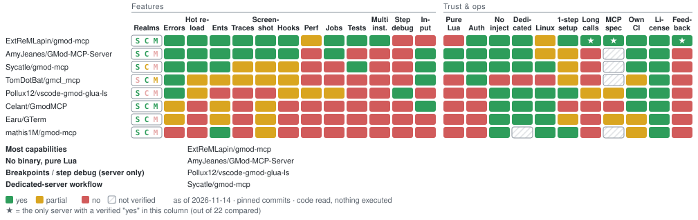
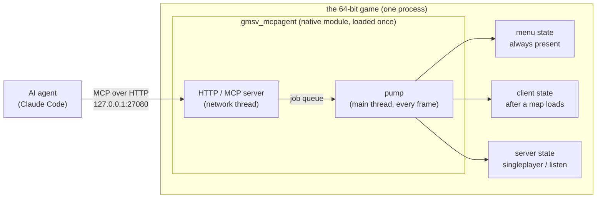
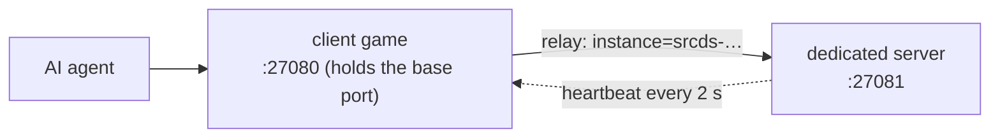

# gmod-mcp

[](https://github.com/ExtReMLapin/gmod-mcp/actions/workflows/build.yml)
[](https://github.com/ExtReMLapin/gmod-mcp/actions/workflows/build.yml)

---- 
##### The GMod MCP server that runs inside the game: Lua in every realm, maps, console, errors, screenshots, hook tracing, test clients and long-running jobs, straight from inside the game.
----

> [!TIP]
> ## Quick start (Claude Code, Windows)
>
> **1.** In Claude Code, run:
>
> ```
> /plugin marketplace add ExtReMLapin/gmod-mcp
> /plugin install gmod-mcp@gmod-mcp
> ```
>
> **2.** Restart Claude Code.
>
> **3.** Ask Claude: **`set up gmod-mcp`**
>
> That's it. Claude installs the module in your game (it asks first) and starts Garry's Mod with `-mcp`.
>
> **4. Turn on updates (recommended):** `/plugin` → **Marketplaces** → `gmod-mcp` → **Enable auto-update**. Claude Code
> keeps auto-update off for marketplaces other than Anthropic's, and no `claude plugin` subcommand turns it on. See
> [Updates](#updates).
>
> Other MCP clients, Linux or a dedicated server: see [Install](#install). Tested with Claude Code 2.1.325.

**An MCP server that lives inside Garry's Mod.** Drop one native module into your game and an AI coding agent
(Claude Code or any MCP client) can run Lua in the menu, client and server realms, load maps, read the console and
errors, inspect and edit the world, take screenshots, trace hooks and look up the documentation — on your own machine.

- **Self-contained**: one DLL, one small Lua file and a small block in `menu.lua` (see
  [What gets modified](#what-gets-modified-in-your-game-folder)). With Claude Code, the plugin brings the module and
  adds a small bridge that Claude Code starts by itself. No Python, no Node, nothing to run yourself.
- **Local only**: listens on `127.0.0.1` with a bearer token, refuses pages from other sites, inactive unless the game
  is started with `-mcp`.
- **Safe by default**: never touches the client realm while you are connected to someone else's server.

## Contents

- [Install](#install)
  - [Claude Code plugin](#claude-code-plugin)
  - [By hand, 1. Garry's Mod side](#by-hand-1-garrys-mod-side-drag-and-drop)
  - [By hand, 2. MCP client side](#by-hand-2-mcp-client-side)
  - [Dedicated server](#dedicated-server)
- [Updates](#updates)
- [Feedback from agents](#feedback-from-agents)
- [Comparison with other servers](#comparison-with-other-servers)
- [Tools](#tools)
  - [Long-running Lua jobs](#long-running-lua-jobs)
  - [Testing a branch: the mounted Lua folder](#testing-a-branch-the-mounted-lua-folder)
- [How it works](#how-it-works)
- [Several games at once](#several-games-at-once)
- [Configuration](#configuration)
- [Security](#security)
- [What gets modified in your game folder](#what-gets-modified-in-your-game-folder)
- [Uninstall](#uninstall)
- [Limitations](#limitations)
- [Building from source](#building-from-source)

## Install

You need Garry's Mod with the **64-bit** binaries (the default on current Steam builds: `bin\win64\gmod.exe`, or
`gmod_win64.exe` at the root of the game folder on older installs). Two ways: the Claude Code plugin (the Quick start at
the top of this page), or by hand for any other MCP client.

### Claude Code plugin

The repository is also a Claude Code plugin marketplace. In Claude Code:

```
/plugin marketplace add ExtReMLapin/gmod-mcp
/plugin install gmod-mcp@gmod-mcp
```

From a shell: `claude plugin marketplace add ExtReMLapin/gmod-mcp`, then `claude plugin install gmod-mcp@gmod-mcp`.
Restart Claude Code, then ask Claude **`set up gmod-mcp`**: its skill copies the two files into the game (after asking
you) and starts the game with `-mcp`. Claude Code stays connected while the game is closed: the tools say so, Claude
starts the game again instead of giving up, and they work again as soon as it is up, no reconnection needed. Updates:
see [Updates](#updates).

The plugin holds:

- the `gmod` MCP server: `gmod-mcp-bridge`, a small stdio program Claude Code starts by itself. It relays to the game,
  stays connected while the game is closed (tools then answer `game_not_running`), and tells Claude Code when the game
  is back. It reads the token from its file, so nothing secret lands in Claude Code's settings;
- the module of the same version, for the game (Windows and Linux binaries);
- one skill: how to install or update the module, find the game folder, start the game with `-mcp`, run several games,
  set up a dedicated server. It asks before touching the game folder and never restarts a game you just closed.

Each release publishes the plugin as one zip (`gmod-mcp-plugin.zip`, pinned by its SHA-256 in the marketplace), so the
repository holds no binaries.

If you added the server by hand earlier (`claude mcp add ... gmod`), the plugin does **not** replace that entry: both
stay and every tool is listed twice. Remove the old one with `claude mcp remove gmod` (add `-s user` if you added it
with `--scope user`; an entry added without a scope only exists in the folder where you ran the command).

Right after the install, Claude Code may say "1 userConfig option not yet set": that is the option that turns the
[feedback offers](#feedback-from-agents) on or off, which is on by default. Nothing to do.

Remove the plugin with `/plugin uninstall gmod-mcp@gmod-mcp`.

### By hand, 1. Garry's Mod side (drag and drop)

1. Download `gmod-mcp-win64.zip` (Windows) or `gmod-mcp-linux64.zip` (a Linux dedicated server) from the
   [latest release](https://github.com/ExtReMLapin/gmod-mcp/releases/latest).
2. Open it. Everything sits in a top folder, `gmod-mcp-win64/` (or `gmod-mcp-linux64/`): drag the `garrysmod` folder
   from inside it onto your game folder (`…\steamapps\common\GarrysMod`, the one that already contains a `garrysmod`
   folder). Accept the merge. That adds two files: `garrysmod/lua/bin/gmsv_mcpagent_win64.dll` and
   `garrysmod/lua/autorun/server/mcpagent_boot.lua`.
3. In Steam: Garry's Mod → Properties → Launch options, add:

   ```
   -mcp
   ```

   Recommended, so the game keeps running at full speed in the background:
   `-mcp -windowed +engine_no_focus_sleep 0 +snd_mute_losefocus 0`
4. Start the game and **load any map once** (Start new game). The module installs its main-menu loader by itself; from
   then on it starts at the main menu every time. The console says
   `[mcpagent] main-menu loader installed …`.

### By hand, 2. MCP client side

Open the game console (`~`) and type:

```
mcpagent_setup
```

It prints the exact setup for your machine, token included. For Claude Code without the plugin, paste this in a
terminal (`--scope user` makes it available in every folder; without it the entry only exists in the folder where you
ran the command):

```
claude mcp add --scope user --transport http gmod http://127.0.0.1:27080/mcp --header "Authorization: Bearer <token>"
```

Restart Claude Code. That's it. The same output also shows a `.mcp.json` snippet for other MCP clients (Streamable
HTTP + bearer token). The token is created once in `%APPDATA%\gmod-mcp\token` (Linux:
`$XDG_CONFIG_HOME/gmod-mcp/token`, `~/.config/gmod-mcp/token` by default), never changes, and is only printed when you
ask for it — keep it private.

Without the plugin, Claude Code only connects if the game is already running when it starts; otherwise use `/mcp`,
Reconnect, once the game is up. The plugin avoids that. Other MCP clients can do the same with `gmod-mcp-bridge` from the
release zip, a stdio server that stays up while the game is closed.

### Dedicated server

Same zip (`gmod-mcp-linux64.zip` for a Linux server), same drag and drop of its `garrysmod` folder into the server's
folder (the one that holds `garrysmod` and the server binary), and start the server with `-mcp`. Only the server realm
exists in that mode. The module is 64-bit: start `srcds_win64.exe` (Linux: `srcds_run_x64`). On Linux the default branch
of the dedicated server has no 64-bit binary: install it with `+app_update 4020 -beta x86-64`.

Linux server branches:

- **`x86-64`** works on Ubuntu 22.04 (glibc 2.35, where it was tested) and newer.
- **`dev`** (64-bit `srcds_linux64`) needs glibc 2.38 and `GLIBCXX_3.4.32` (Ubuntu 24.04 or newer): the server binary itself
  does not start on older systems, with or without the module.
- **The public (default) branch is 32-bit only.** The module is 64-bit and is not loaded there; the server starts normally,
  without gmod-mcp and without a crash.

`game_quit` on a dedicated server: the engine blocks the console `quit` from server Lua, so on Linux the module ends the
process itself with `SIGTERM` (the server's own clean shutdown) half a second after it answered. On a Windows dedicated server
there is no such path and `game_quit` answers the error `blocked` (stop the server from its console, or use
`game_terminate`, which kills it at once). `game_terminate` works the same on both systems.

`mcpagent_setup` works in the server console too. The plugin and the bridge reach a server running on your machine
like a game: a server alone takes port 27080; next to a client game, use `instances_list` and pass `instance`
(see [Several games at once](#several-games-at-once)). The plugin's skill can also set a server up for you.

## Updates

- **What updates by itself.** With auto-update on (`/plugin` → **Marketplaces** → `gmod-mcp` → **Enable auto-update**),
  Claude Code updates the plugin a few minutes after a session starts; the new version runs from the next start of
  Claude Code (or after `/reload-plugins`). Claude Code keeps it off for third-party marketplaces and no `claude plugin`
  subcommand turns it on: use that menu.
- **By hand**, in a shell:

  ```
  claude plugin marketplace update gmod-mcp
  claude plugin update gmod-mcp@gmod-mcp
  ```

  then restart Claude Code (or `/reload-plugins`). The first command matters: Claude Code compares with its local copy
  of the marketplace, and without refreshing it `plugin update` answers "already at the latest version".
- **What is in the plugin**: the bridge Claude Code talks to, the skill, and a copy of the module for the game.
- **What does not update by itself: the module loaded by the game** (`garrysmod/lua/bin/gmsv_mcpagent_*.dll`). After a
  plugin update, quit Garry's Mod and ask Claude **`update gmod-mcp`**: the skill copies the new module into the game.
  Until then, tool results carry a warning that names both versions: the bridge learns the module's version when the
  game first answers, so it shows from a moment after that, and the server instructions carry it too.
- **Without the plugin**: quit the game (it keeps the DLL locked), download the new zip from the
  [releases](https://github.com/ExtReMLapin/gmod-mcp/releases/latest) and overwrite the two files. The version warning
  is a feature of the bridge, so only the plugin gives it.
- **What the commands download**: `/plugin marketplace add` clones this repository (to read its
  `.claude-plugin/marketplace.json`); `/plugin install` and updates download only the release zip of that version
  (`gmod-mcp-plugin.zip`, checked against its SHA-256), not the source code.

## Feedback from agents

Agents using gmod-mcp are asked (server instructions, guide, skill) to note the frictions they meet with it and, at the
end of a task, to offer you to report the ones that cost real time or a feature. If you agree, they draft the issue in
English with no secrets, paths, project names or code, look for duplicates, and file it with `gh` when it is installed
and signed in (otherwise they give you a prefilled link: one click). Issues carry the `agent-feedback` label.

To turn the offers off, set the plugin option `feedback_offers` (on by default) to false: `/plugin configure
gmod-mcp@gmod-mcp` in Claude Code, or in a shell:

```
echo '{"feedback_offers": "false"}' | claude plugin configure gmod-mcp@gmod-mcp --values-stdin
```

Then restart Claude Code.

## Comparison with other servers

**As of 2026-11-14, gmod-mcp covers the most capabilities of the 22 Garry's Mod MCP servers we compared.** Code read, nothing executed · [method & full table](https://github.com/ExtReMLapin/gmod-mcp/blob/main/docs/COMPARISON.md)

<picture>
  <source media="(prefers-color-scheme: dark)" srcset="https://raw.githubusercontent.com/ExtReMLapin/gmod-mcp/main/docs/comparison/comparison-dark.svg">
  
</picture>

Repos: [ExtReMLapin/gmod-mcp](https://github.com/ExtReMLapin/gmod-mcp) · [AmyJeanes/GMod-MCP-Server](https://github.com/AmyJeanes/GMod-MCP-Server) · [Sycatle/gmod-mcp](https://github.com/Sycatle/gmod-mcp) · [TomDotBat/gmcl_mcp](https://github.com/TomDotBat/gmcl_mcp) · [Pollux12/vscode-gmod-glua-ls](https://github.com/Pollux12/vscode-gmod-glua-ls) · [Celant/GmodMCP](https://github.com/Celant/GmodMCP) · [Earu/GTerm](https://github.com/Earu/GTerm) · [mathis1M/gmod-mcp](https://github.com/mathis1M/gmod-mcp) · [14 more](https://github.com/ExtReMLapin/gmod-mcp/blob/main/docs/COMPARISON.md)

## Tools

| Area | Tools |
|---|---|
| Session | `status`, `map_list`, `map_load`, `disconnect`, `game_quit`, `game_terminate`, `wait_for`, `wait_frames` |
| Lua | `lua_exec`, `lua_exec_file`, `lua_reload` (run an addon file again from the disk, in its realms), `lua_check` (syntax and globals of a snippet, file or whole addon, without running it), `lua_job` (long work spread over frames, with progress; `async: true` with `lua_job_status` / `lua_job_cancel`), `lua_inspect`, `lua_function_source` (is a running function the code on disk?), `lua_mount` (this game loads Lua from your worktree first), `lua_file_write` / `_read` / `_list` / `_delete`, `tests_run` (GLuaTest format) |
| Hooks | `hook_list`, `hook_trace`, `perf_hook_cost` |
| Console | `console_exec` (`a 1; b 2` runs two commands like the console; an unknown command is an error; convars it sets are read back), `console_read`, `console_wait` (block until N lines match, e.g. the end of a batch), `console_buffer`, `convar_get`, `convar_set`, `concommand_list` |
| Errors | `errors_since`, `errors_clear` (Lua errors from all three realms, with stack) |
| World | `ents_find`, `ent_info`, `ent_spawn`, `ent_remove`, `ent_fire`, `players_list`, `player_set`, `bots_add`, `trace`, `trace_through` (every surface crossed, with thickness and material) |
| Rendering | `screenshot` (works at the main menu, in a dialog and on a loading screen too, on Windows), `screenshot_from` (arbitrary camera), `debug_draw`, `debug_clear` |
| UI input | `ui_click` (click or scroll at a pixel of a `screenshot`), `ui_key` (keys and text; characters outside the machine's ANSI code page are refused, the engine would alter them): dialogs, Derma and menu buttons that have no console command. Windows test clients only; posted to the game's own window, your real mouse and focus are untouched |
| Sound | `sound_emit`, `sound_trace` |
| Performance | `perf_snapshot` |
| Documentation | `api_search` (what really exists in each realm), `wiki_search`, `wiki_page` (wiki.facepunch.com, cached) |
| Events | `events_wait` (long-poll: `map_loaded`, `lua_error`, `main_thread_stalled`…), `reports_read` / `reports_channels` / `reports_clear` (fed by `mcpagent.report()` from your scripts) |
| Instances | `instances_list`; with the plugin (Windows): `instances_launch` (1 to 8 test clients), `instances_close`, `instance_select` (the session's default instance) |

Besides tools, the server offers:

- **Prompts** (slash commands in Claude Code): `write-lua-job`, `debug-errors`, `run-tests`, `check-map`, with
  completion of map names, realms and test files.
- **Resources**: the agent guide (`mcpagent://guide`), `gmod://errors` and `gmod://console` (subscribable: the client is
  told when they change), and the templates `gmod://wiki/{page}` and `gmod://lua/{path}`.
- **Progress and cancellation**: long tools report progress while they run, and stop when the client cancels.
  Long operations (`map_load`, long waits, long jobs) run as background MCP Tasks for clients that support them.
- **Confirmation**: changing a convar saved in your `config.cfg` asks you first (when the client supports it).

### Long-running Lua jobs

`lua_exec` runs code in one go, and the game is frozen while it runs. For anything longer, `lua_job` runs the script
as a coroutine resumed once per frame. The script talks back through a `job` object, and its progress shows up in
Claude Code while it runs:

```lua
local props = 0
local all = ents.GetAll()
for i, ent in ipairs(all) do
    if ent:GetClass() == "prop_physics" then props = props + 1 end
    if i % 100 == 0 then job:progress(i, #all, props .. " props so far") end
    job:step()  -- hands control back to the game once this frame's time slice is used
end
return { props = props }
```

Also available: `job:sleep(seconds)`, `job:frames(n)`, `job:wait(fn, timeout)`, `job:report(value)` for intermediate
results, and `args` (also `job.args`) for the call's arguments. `async: true` returns at once with a job id
(`lua_job_status`, `lua_job_cancel`), and `fresh_env: true` keeps the script's globals out of the game's `_G`. The agent learns this protocol from the tool description and the
`write-lua-job` prompt.

### Testing a branch: the mounted Lua folder

Every game process loads the addons from the same `garrysmod/addons/` folder, so an agent that works in a git worktree
of an addon cannot test its branch in one test client without changing the folder every other client (and your own
game) uses. The mounted folder solves this per process: `lua_mount {path: "D:/dev/my-addon-wt"}` (or
`instances_launch {lua_mount: "D:/dev/my-addon-wt"}` for a new test client) makes that one game look for Lua files in the
worktree before every addon. `include()`, autorun files and `AddCSLuaFile` then get the branch's files, at every map
load, and the other games keep the installed addon.

```
instances_launch {count: 1, owner: "fork-a", lua_mount: "D:/dev/my-addon-wt", map: "gm_construct"}
lua_function_source {realm: "server", expr: "MyAddon.Update"}   -> source: the worktree's file
```

- `path` is the addon's root (the folder that contains `lua/`) or its `lua/` folder, absolute. Its `gamemodes/` folder
  is overlaid too (materials, sounds and models are not: see the table below).
- The path must be ASCII-only: the game's file system lists a folder with non-ASCII characters but loads none of its
  files, so `lua_mount` refuses it. Use an ASCII junction instead (`mklink /J C:\dev\my-addon "D:\Développement\my-addon"`).
- **It applies to files loaded from then on.** Code that already runs is not run again: after `lua_mount`, call
  `map_load`. `instances_launch {lua_mount}` sets it before the first map, so nothing more is needed there.
- `lua_mount {}` shows the current mounted folder and the engine's Lua search paths; `lua_mount {path: null}` removes it
  (from the next map load).
- The engine caches Lua files by name and file time; `lua_mount` empties that cache when it changes (so an addon file
  and its worktree copy with the same name and time cannot be mixed up).
Example: the worktree `D:/dev/my-addon-wt` of the addon installed as `garrysmod/addons/my_addon`, mounted with
`lua_mount {path: "D:/dev/my-addon-wt"}` then `map_load`:

| File on disk | What this game does with it |
|---|---|
| `D:/dev/my-addon-wt/lua/autorun/my_addon.lua` | runs as `autorun/my_addon.lua` (instead of the installed one) |
| `D:/dev/my-addon-wt/lua/my_addon/core.lua` | what `include("my_addon/core.lua")` loads |
| `D:/dev/my-addon-wt/lua/my_addon/new.lua` (only in the branch) | found by `include("my_addon/new.lua")` |
| `garrysmod/addons/my_addon/lua/my_addon/old.lua` (deleted in the branch) | still loaded from the installed addon |
| `D:/dev/my-addon-wt/gamemodes/<gm>/...` | gamemode files |
| `materials/`, `sound/`, `models/`, anything else | not mounted |

- What sees the mounted folder (checked in game): autorun files, `include()`, `AddCSLuaFile` (the client gets the
  folder's copy), the console's `lua_openscript` / `lua_openscript_cl`, `file.Read` / `file.Find` with `"LUA"`, and
  gmod-mcp's `lua_exec_file`, `lua_job {path}`, `lua_check`, `lua_reload` and `lua_function_source`, which look in the
  same order as the engine. Not affected: materials, sounds, models, `data/`.
- A file of the folder hides the installed addon's file with the same Lua path; files only in the game are still
  loaded, including a file your branch deleted.
- The engine names the folder's files from the folder's root: `debug.getinfo(f).source` is `@lua/my_addon/x.lua`, not
  `@addons/my_addon/lua/my_addon/x.lua`.
- No autorefresh: `status.lua_mount.stale_files` lists the folder's files that changed since each realm loaded them;
  `lua_reload {mounted_changed: true}` runs them again (or `lua_reload {path}` for one file, or `map_load`), then
  `lua_function_source` to check that the running function is the file's. A reload re-runs the file: it does not undo
  hooks or entities the old copy created. `map_load` warns when the folder changed during the load, and empties the
  engine's Lua file cache first.
- Which copy ran: `lua_function_source` and `lua_inspect` on a function return `from_mount` and the real `disk` path
  (`@lua/x.lua` is the same name for the folder's copy and an installed one). It is recorded when the folder was put
  in front of the realm's Lua path, not guessed from the name.
- Windows game clients only for now: not on Linux (the engine's filesystem interface is not verified there) nor on a
  dedicated server (its filesystem interface is not reachable the same way).
- How it works: the engine's own search paths (`IFileSystem::AddSearchPath` at the head of the Lua path IDs), put back
  in front at every map start; see [docs/REVERSE.md](https://github.com/ExtReMLapin/gmod-mcp/blob/main/docs/REVERSE.md#lua-mount-search-paths). Nothing is written to
  the game folder.

## How it works

A Garry's Mod process runs up to three Lua states: **menu** (always there), **client** and **server** (created when a
map loads, destroyed when it unloads). The module is loaded once per process, in the menu state, and drives the other
two, re-injecting its small Lua runtime each time a map loads.



All Lua runs on the game's main thread; the network thread only queues work, so a frozen game can still be inspected
(`status`) and killed (`game_terminate`).

With the plugin, Claude Code does not talk to the game directly: it starts `gmod-mcp-bridge` (stdio) and the bridge
relays every message to the game over that same HTTP connection. The bridge listens on nothing, answers while the game
is closed (every tool listed, calls saying the game is not running), tells Claude Code when the game is back, and holds
the tools that must work without a game: `instances_launch`, `instances_close`, `instance_select`.

## Several games at once

Each game process (a client, a dedicated server…) has **its own** MCP server on its own port: 27080, then 27081,
27082… Nothing is shared between processes except a directory.



- The process holding the base port also acts as a **directory and relay**: `instances_list` shows every running game,
  and any tool accepts an `instance` argument to target another game. So Claude Code needs a single entry.
- With **one** game running, nothing changes: no `instance` needed. With **several**, calls without `instance` are
  refused with `ambiguous_instance` (listing the ids) instead of guessing, and every answer says which game produced it
  (`answered_by`).
- A game that **crashes** is told apart from one that quit: calls to it answer `client_crashed` (`server_crashed` for a
  dedicated server) with the name of the crash dump in `crashes/` (when one was written) and the exit code, and
  `instances_list` shows it as `crashed` for an hour. The coordinator decides from the game's own goodbye at shutdown, a
  `game_quit`/`game_terminate` sent through it, a dump written just before the process ended, and its exit code. A process
  killed from outside with no dump looks like a crash with exit code 1. A call in flight to a game that dies is answered at
  once, and the answer carries the free memory of the machine (out of memory is a likely cause).
- A game that is **hung** is flagged: `instances_list` gives `stalled_s` (seconds its main thread has been blocked) and
  `fps_low_s` (seconds under 10 fps), and the state becomes `hung` after 60 s (180 s during a map load) with the advice to close
  and relaunch; a call to a frozen process fails with `instance_hung` after 30 s without heartbeat. `instances_launch` checks
  the free commit and RAM first and refuses with `low_memory` (the figures, how many clients run) when they cannot hold the
  clients; `ignore_low_memory: true` overrides it.
- If the game holding the base port exits, the others keep running; within a few seconds one of them takes the base port
  over and the rest register with it.

Several **clients** can run side by side too. With the Claude Code plugin, the `instances_launch` tool starts 1 to 8
test clients (small window, frame cap, Windows for now), `instances_close` closes them (by id, pid or owner label),
and `instance_select` sets the default instance of a session. Its description gives the measured cost: about 1.5 GB of
RAM and a fifth of a CPU core per client. Sub-agents of one Claude Code session share that session: each one labels its
clients with `owner` and closes only those. The label travels with the game (command line and heartbeat), so
`instances_list` shows it on every instance and `instances_close {owner}` still finds clients started with `keep: true`
by an earlier session; it never closes a game that is not one of our test clients.

<!-- FP7137: agent-facing text A1-A3, see docs/FP7137.md -->
Starting a game makes every other running Garry's Mod release its GPU resources for 2-10 s, and a map load ending in
that window crashes that game (engine bug, [Facepunch garrysmod-issues#7137](https://github.com/Facepunch/garrysmod-issues/issues/7137)).
The bridge therefore makes `instances_launch` and `map_load` wait for each other (every session of the user shares the
lock; `waited_s` / `waited_reason` in the result, errors `map_load_in_progress` / `launch_in_progress` when the wait would
exceed `timeout_s`), and `instances_launch {map}` loads its maps after a 15 s settle delay; at most 2 maps load at a time across all sessions (a third `map_load` or launch load waits, `map_load_in_progress` at the timeout). It also sees map
loads it did not start (console `map`, Lua, a script talking to the game: every game reports `loading` in `instances_list`),
`instances_launch` waits for them too and `map_load` lists them (`other_games_loading`). It cannot hold back a game you
start by hand, nor a console or Lua map load started while a launch is creating its processes: do not do those while
other games load or launch.
Right after a game starts, the other games can be unreachable for 15-18 s (`instance_unreachable`): wait and retry. Best
order: launch all clients in one `instances_launch`, then work. `GMOD_MCP_FP7137_WORKAROUND=0` turns the wait off.
The game that holds the base port is the coordinator (`instances_list` shows it): when it ends, another game takes the role over in about 3 s and calls with `instance` answer the retryable `coordinator_changing` meanwhile (the bridge retries for 10 s); `instances_close` says when it closed the coordinator.

The clients share the game folder with your own game, including `data/` and the cookies (`sv.db`/`cl.db`): a test
that writes there changes your game too.

> **Test clients leave your video settings alone.** Garry's Mod normally saves the window size it was started with as
> its video setting (resolution, anti-aliasing, ... in the registry). `instances_launch` starts its clients with
> `-dxlevel 95`, the level the engine keeps on current hardware: with that option the engine neither reads nor writes
> those settings, so your own resolution is still there at your next start. (Clients that older versions of gmod-mcp
> started could overwrite it: if your game opens small, set the resolution again in the video options. Clients you
> start by hand with `-w`/`-h` still save their size: add `-dxlevel 95` to avoid it.)

> **Test clients leave your frame cap and focus options alone.** `instances_launch` starts its clients with `+fps_max 20`
> (30 for the `normal` preset), `+fps_max_nofocus` and `+snd_mute_losefocus 0`. Those convars are saved into
> `cfg/config.cfg` when a game quits cleanly, and your own game reads the same file: a test client that quit would have
> left your `fps_max` at 20. The clients now carry `-mcp_test_client`, and before one quits cleanly (`game_quit`, a `quit`
> sent through `console_exec`, the main menu's Quit button, the window's close button) the module sets each of these
> convars back to the value your `config.cfg` has at that moment, or to the convar's default when the file has no line
> for it. Not covered: a `quit` typed by hand in a test client's console. `instances_close` kills the process, which
> saves nothing. (A client that older versions started and then quit may have changed `fps_max` in your config: check it
> in the options.)

**Frame cap, extra options and startup commands for test clients.** `instances_launch` takes a few options for what the
presets do not cover (they are checked before anything starts; a refused one is `invalid_params` naming it):

```
instances_launch {count: 1, fps_max: 300, fps_max_nofocus: 0,
                  commands: ["snd_mute_losefocus 0", "cl_showfps 1"],
                  launch_args: ["-noborder"], map: "gm_construct"}
```

- `fps_max` and `fps_max_nofocus` (integers, `0` = no cap, otherwise 10 to 1000) replace the preset's frame cap
  (`fps_max_nofocus` follows `fps_max` when only that one is given). The result says what the clients run at (`fps_max`,
  `fps_max_nofocus`, `fps_note`).
- `commands` are console commands run on each client once it answers, before the map loads, in order; `instances[].commands`
  says how each went. `quit`/`exit`, `connect`/`retry`/`redirect`/`connect_lobby` (gmod-mcp never connects to a server) and
  map changes (`map`, `changelevel`, `load`: use `map`) are refused.
- `launch_args` are extra engine command-line tokens, one per array element (`["+cl_showfps", "1"]`, a word without
  spaces, quotes or `;`). Refused: what gmod-mcp sets itself (`-multirun`, `-mcp*`, `-w`, `-h`, `-width`, `-height`, the
  window-mode options, `-dxlevel`, `-condebug`, `-game`), `+connect` and `+map`. The options are listed on the Valve
  Developer Community, [Command line options](https://developer.valvesoftware.com/wiki/Command_line_options) (and the
  Garry's Mod wiki for the GMod-specific ones); console commands and convars are listed by `api_search` and
  `concommand_list`.

The archived convars these options change (`fps_max`, a `+convar` token, a command such as `cl_showfps 1` or `toggle
snd_mute_losefocus`) are given back to your value before a clean quit, exactly like the built-in ones above (the bridge
lists their names to the module with `-mcp_restore_convars`; this needs the module of the same release, an older one
restores only the four it knew). A convar changed by `exec` of a cfg file is not tracked.

## Configuration

| Launch option | Effect |
|---|---|
| `-mcp` | Required. Without it the module prints one line and does nothing (and never touches any file). |
| `-mcpport <n>` | Base port, 1 to 65000 (default `27080`; anything else falls back to it). The module tries the base port, then the 15 next ones, and refuses to start if none is free. |

The bridge only talks to the base port. If you changed it with `-mcpport`, tell the bridge the same number: with the
plugin, set the `GMOD_MCP_PORT` environment variable for Claude Code (`--port <n>` is for running `gmod-mcp-bridge`
yourself, in another MCP client's configuration). It also matters when another program already holds port 27080: the
game then takes the next free port (its console line `[mcpagent] active: ... http://127.0.0.1:<port>/mcp` says which)
and the bridge does not look there. Free port 27080, or start the game with `-mcpport <free port>` and set
`GMOD_MCP_PORT` to that port. The bridge recognises the situation: gmod-mcp signs every answer with an `X-Gmod-Mcp`
header, so a port that answers without it is held by another program, and the tools then answer `port_conflict` (not
`game_not_running`), naming the port, how to find the program (`Get-NetTCPConnection -LocalPort 27080` on Windows,
`ss -ltnp` on Linux) and, when it finds one on the next ports, the `GMOD_MCP_PORT` value to use.

Scratch Lua files for the agent go to `garrysmod/lua/mcpagent_tmp/` (`status` gives the absolute path); errors and
tracebacks then point at the real file.

## Security

- Binds to `127.0.0.1` only. Every request needs the bearer token; a browser `Origin` other than a local one
  (`localhost`, `127.0.0.1`, `[::1]`) is refused, and the `Host` header must be loopback with the right port (DNS
  rebinding). The bridge opens no port at all.
- The only outbound traffic is HTTPS GET requests to `wiki.facepunch.com`, through the game's own HTTP client.
- **Client realm lock.** Running Lua in the client state bypasses `sv_allowcslua`, like a cheat would. The module refuses
  to touch the client realm unless the server runs on your own machine: the game hosts it (singleplayer, listen server),
  or its address is loopback or exactly one of this machine's own network addresses (a local dedicated server). On any
  other server, even on your LAN, nothing is injected into the client, client calls fail with `client_locked` and
  `status` says why. This cannot be disabled.
- `console_exec` refuses `connect`/`redirect` to servers that are not on this machine (including after a `;`). A
  `connect` must also be alone on its line: `echo x; connect ...` is refused, because the engine crashes on it while a
  map is loaded. `convar_set` refuses archived convars (they would end up in your `config.cfg`) unless asked explicitly.

## What gets modified in your game folder

- The two files from the zip.
- **`garrysmod/lua/menu/menu.lua`**: Garry's Mod has no plugin folder for the main menu, so the module appends a small
  block between `-- MCPAGENT BEGIN` and `-- MCPAGENT END` (the original is saved once as `menu.lua.mcpagent.bak`). The
  block is written to be harmless: everything runs inside `pcall`, an obviously broken or empty DLL is skipped instead of
  triggering a Windows error dialog, and if a load ever crashes the game, the next start skips the module and tells you
  why. The file is only written when the game runs with `-mcp`, and only if
  the result compiles.
- **Steam "Verify integrity of game files"** will report `menu.lua` as modified and restore the original — that is
  expected. Game updates do the same. The block comes back by itself the next time you play with `-mcp` and load a map.
- `garrysmod/data/mcpagent/` (wiki cache) and `garrysmod/lua/mcpagent_tmp/` (agent scratch files).

## Uninstall

1. Keep `-mcp` in the launch options for now: `mcpagent_uninstall` only exists while the module is loaded. Start the
   game, and at the main menu type in the console: `mcpagent_uninstall`. It removes the block from `menu.lua`, which is
   then byte-identical to the original.
2. Quit the game, then remove `-mcp` from the Steam launch options.
3. Delete `garrysmod/lua/bin/gmsv_mcpagent_win64.dll` (Linux: `gmsv_mcpagent_linux64.dll`),
   `garrysmod/lua/autorun/server/mcpagent_boot.lua` and the backup `garrysmod/lua/menu/menu.lua.mcpagent.bak`.
4. Optionally delete `garrysmod/data/mcpagent`, `garrysmod/lua/mcpagent_tmp` and the token folder (`%APPDATA%\gmod-mcp`,
   Linux: `~/.config/gmod-mcp`).
5. With the plugin: `/plugin uninstall gmod-mcp@gmod-mcp`, then `claude plugin marketplace remove gmod-mcp`. A server
   added by hand: `claude mcp remove gmod`.

## Limitations

- Tested on Windows x64 (game and dedicated server) and in a Linux x64 dedicated server. The Linux client game has not
  been tested. `instances_launch` is Windows only.
- The very first start needs one map load (to install the main-menu loader).
- Without a loaded map, `screenshot` runs the engine's own `jpeg` command: the engine writes a file in `garrysmod/screenshots/`,
  the module reads exactly the file the engine names in its console and deletes it (nothing else is touched). It works while other
  windows cover the game, but not while the game is minimized or frozen (`capture_timeout`). The image is the engine's JPEG at the
  game's screen size and quality: no HUD choice, no `w`/`h`, no PNG. `screenshot_from` and the `render` source need a loaded map.
- `hook_trace` adds a temporary hook: if another hook returns a value first, that call is not seen.
- The Garry's Mod dedicated server ignores packets from `127.0.0.1`: to join a local dedicated server, connect to this
  machine's LAN address (the client lock recognizes it as local).
- Lua errors raised by code run through `lua_exec` are returned to the caller, not reported by `errors_since`.
- A `lua_job` dies with its realm: loading a map ends the jobs running in the client and server states.
- Progress and cancellation do not cross instances: a call relayed to another game reports neither.
- MCP logging, sampling and roots (deprecated in the 2026-07-28 specification) are not implemented.

## Building from source

Requirements: CMake 3.24+, a C++17 compiler (MSVC 2022 or GCC 11+), internet access at configure time (dependencies are
fetched and verified by SHA-256).

```sh
cmake -S . -B build -DCMAKE_BUILD_TYPE=Release
cmake --build build --config Release
```

The output in `build/` is the module, `gmsv_mcpagent_win64.dll` (or `_linux64.dll`), and the bridge,
`gmod-mcp-bridge`; `loader/mcpagent_boot.lua` is the autorun file. The build also runs `gmod-mcp-snapshot`, which writes
the module's tool descriptions into the bridge (served while the game has never answered).

Tests without a game: `python tests/bridge/test_bridge.py <bridge>` (a fake game server covers the protocol and the
odd cases) and `python tests/protocol/check_constants.py` (protocol constants against the official schema). CI runs
both on Windows and Linux.
The test matrix is in [docs/TESTS.md](https://github.com/ExtReMLapin/gmod-mcp/blob/main/docs/TESTS.md); notes on the engine interfaces used are in
[docs/REVERSE.md](https://github.com/ExtReMLapin/gmod-mcp/blob/main/docs/REVERSE.md).

## License

MIT — see [LICENSE](https://github.com/ExtReMLapin/gmod-mcp/blob/main/LICENSE) and [THIRD_PARTY_NOTICES.md](https://github.com/ExtReMLapin/gmod-mcp/blob/main/THIRD_PARTY_NOTICES.md). Not affiliated with Facepunch
Studios or Valve.
