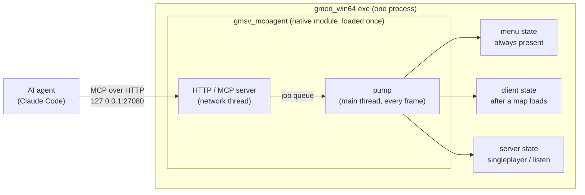
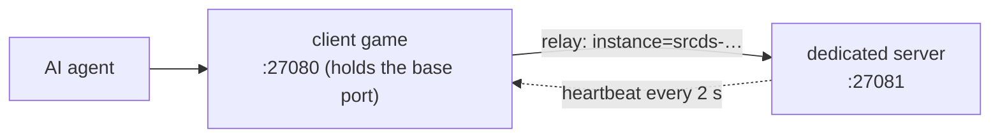

# gmod-mcp

**An MCP server that lives inside Garry's Mod.** Drop one native module into your game and an AI coding agent
(Claude Code or any MCP client) can run Lua in the menu, client and server realms, load maps, read the console and
errors, inspect and edit the world, take screenshots, trace hooks and look up the documentation — on your own machine.

- **Self-contained**: one DLL and one small Lua file, both in the release zip. No Python, no Node, no sidecar process.
- **Local only**: listens on `127.0.0.1` with a bearer token, refuses browser origins, inactive unless the game is
  started with `-mcp`.
- **Safe by default**: never touches the client realm while you are connected to someone else's server.

## Contents

- [Install](#install)
  - [1. Garry's Mod side (drag and drop)](#1-garrys-mod-side-drag-and-drop)
  - [2. Claude Code side (one command)](#2-claude-code-side-one-command)
  - [Dedicated server](#dedicated-server)
  - [Claude Code plugin](#claude-code-plugin)
- [Tools](#tools)
  - [Long-running Lua jobs](#long-running-lua-jobs)
- [How it works](#how-it-works)
- [Several games at once](#several-games-at-once)
- [Configuration](#configuration)
- [Security](#security)
- [What gets modified in your game folder](#what-gets-modified-in-your-game-folder)
- [Uninstall](#uninstall)
- [Limitations](#limitations)
- [Building from source](#building-from-source)

## Install

You need Garry's Mod with the **64-bit** binaries (`gmod_win64.exe`, the default on current Steam builds).

**Quickest, with Claude Code:** install the plugin, then ask Claude to set up gmod-mcp. Its skill downloads and checks
the release, copies the two files (after asking you), starts the game with `-mcp` and connects Claude Code. Later, when
the game is closed, Claude knows to start it again instead of giving up:

```
/plugin install gmod-mcp --marketplace ExtReMLapin/gmod-mcp
```

Or by hand, in two steps:

### 1. Garry's Mod side (drag and drop)

1. Download `gmod-mcp-win64.zip` from the [latest release](../../releases/latest).
2. Open it and drag its `garrysmod` folder onto your game folder
   (`…\steamapps\common\GarrysMod`, the one that already contains a `garrysmod` folder). Accept the merge.
   That adds two files: `garrysmod/lua/bin/gmsv_mcpagent_win64.dll` and
   `garrysmod/lua/autorun/server/mcpagent_boot.lua`.
3. In Steam: Garry's Mod → Properties → Launch options, add:

   ```
   -mcp
   ```

   Recommended, so the game keeps running at full speed in the background:
   `-mcp -windowed +engine_no_focus_sleep 0 +snd_mute_losefocus 0`
4. Start the game and **load any map once** (Start new game). The module installs its main-menu loader by itself; from
   then on it starts at the main menu every time. The console says
   `[mcpagent] main-menu loader installed …`.

### 2. Claude Code side (one command)

Open the game console (`~`) and type:

```
mcpagent_setup
```

It prints the exact command for your machine, token included. Paste it in a terminal:

```
claude mcp add --transport http gmod http://127.0.0.1:27080/mcp --header "Authorization: Bearer <token>"
```

Restart Claude Code. That's it. The same output also shows a `.mcp.json` snippet for other MCP clients (Streamable
HTTP + bearer token). The token is created once in `%APPDATA%\gmod-mcp\token` (Linux: `~/.config/gmod-mcp/token`), never
changes, and is only printed when you ask for it — keep it private. You can quit and restart the game while Claude Code
stays open: calls fail with "connection refused" while the game is closed and work again as soon as it is back (the
server keeps no session).

### Dedicated server

Same zip, same drag and drop into the server's folder, and start the server with `-mcp`. Only the server realm exists
in that mode.

### Claude Code plugin

The repository is also a Claude Code plugin marketplace. The plugin (`plugin/`) holds one skill, no code: it tells
Claude how to install or update the module, find the game folder, start the game with `-mcp` when the `gmod` server is
down, wait for it and register it with `claude mcp add`. It asks before touching the game folder and never restarts a
game you just closed.

```
/plugin install gmod-mcp --marketplace ExtReMLapin/gmod-mcp
```

From a shell: `claude plugin install gmod-mcp --marketplace ExtReMLapin/gmod-mcp`.

## Tools

| Area | Tools |
|---|---|
| Session | `status`, `map_list`, `map_load`, `disconnect`, `game_quit`, `game_terminate`, `wait_for`, `wait_frames` |
| Lua | `lua_exec`, `lua_exec_file`, `lua_check` (syntax and globals of a snippet, file or whole addon, without running it), `lua_job` (long work spread over frames, with progress), `lua_inspect`, `lua_file_write` / `_read` / `_list` / `_delete`, `tests_run` (GLuaTest format) |
| Hooks | `hook_list`, `hook_trace`, `perf_hook_cost` |
| Console | `console_exec`, `console_read`, `console_buffer`, `convar_get`, `convar_set`, `concommand_list` |
| Errors | `errors_since`, `errors_clear` (Lua errors from all three realms, with stack) |
| World | `ents_find`, `ent_info`, `ent_spawn`, `ent_remove`, `ent_fire`, `players_list`, `player_set`, `bots_add`, `trace`, `trace_through` (every surface crossed, with thickness and material) |
| Rendering | `screenshot`, `screenshot_from` (arbitrary camera), `debug_draw`, `debug_clear` |
| Sound | `sound_emit`, `sound_trace` |
| Performance | `perf_snapshot` |
| Documentation | `api_search` (what really exists in each realm), `wiki_search`, `wiki_page` (wiki.facepunch.com, cached) |
| Events | `events_wait` (long-poll: `map_loaded`, `lua_error`, `main_thread_stalled`…), `reports_read` / `reports_channels` / `reports_clear` (fed by `mcpagent.report()` from your scripts) |
| Instances | `instances_list` |

Besides tools, the server offers:

- **Prompts** (slash commands in Claude Code): `write-lua-job`, `debug-errors`, `run-tests`, `check-map`, with
  completion of map names, realms and test files.
- **Resources**: the agent guide (`mcpagent://guide`), `gmod://errors` and `gmod://console` (subscribable: the client is
  told when they change), and the templates `gmod://wiki/{page}` and `gmod://lua/{path}`.
- **Progress and cancellation**: long tools report progress while they run, and stop when the client cancels.
  Long operations (`map_load`, long waits, long jobs) run as background MCP Tasks for clients that support them.
- **Confirmation**: changing a convar saved in your `config.cfg` asks you first (when the client supports it).

### Long-running Lua jobs

`lua_exec` runs code in one go, and the game is frozen while it runs. For anything longer, `lua_job` runs the script
as a coroutine resumed once per frame. The script talks back through a `job` object, and its progress shows up in
Claude Code while it runs:

```lua
local props = 0
local all = ents.GetAll()
for i, ent in ipairs(all) do
    if ent:GetClass() == "prop_physics" then props = props + 1 end
    if i % 100 == 0 then job:progress(i, #all, props .. " props so far") end
    job:step()  -- hands control back to the game once this frame's time slice is used
end
return { props = props }
```

Also available: `job:sleep(seconds)`, `job:frames(n)`, `job:wait(fn, timeout)`, `job:report(value)` for intermediate
results, and `job.args` for the call's arguments. The agent learns this protocol from the tool description and the
`write-lua-job` prompt.

## How it works

A Garry's Mod process runs up to three Lua states: **menu** (always there), **client** and **server** (created when a
map loads, destroyed when it unloads). The module is loaded once per process, in the menu state, and drives the other
two, re-injecting its small Lua runtime each time a map loads.



All Lua runs on the game's main thread; the network thread only queues work, so a frozen game can still be inspected
(`status`) and killed (`game_terminate`).

## Several games at once

Each game process (a client, a dedicated server…) has **its own** MCP server on its own port: 27080, then 27081,
27082… Nothing is shared between processes except a directory.



- The process holding the base port also acts as a **directory and relay**: `instances_list` shows every running game,
  and any tool accepts an `instance` argument to target another game. So Claude Code needs a single entry.
- With **one** game running, nothing changes: no `instance` needed. With **several**, calls without `instance` are
  refused with `ambiguous_instance` (listing the ids) instead of guessing, and every answer says which game produced it
  (`answered_by`).
- If the game holding the base port exits, the others keep running; within a few seconds one of them takes the base port
  over and the rest register with it.

## Configuration

| Launch option | Effect |
|---|---|
| `-mcp` | Required. Without it the module prints one line and does nothing (and never touches any file). |
| `-mcpport <n>` | Base port (default `27080`). If it is taken, the next free port is used. |

Scratch Lua files for the agent go to `garrysmod/lua/mcpagent_tmp/` (`status` gives the absolute path); errors and
tracebacks then point at the real file.

## Security

- Binds to `127.0.0.1` only. Every request needs the bearer token; requests with an `Origin` header (browsers) are
  rejected and the `Host` header must be loopback with the right port (DNS rebinding).
- The only outbound traffic is HTTPS GET requests to `wiki.facepunch.com`, through the game's own HTTP client.
- **Client realm lock.** Running Lua in the client state bypasses `sv_allowcslua`, like a cheat would. The module refuses
  to touch the client realm unless the server runs on your own machine: the game hosts it (singleplayer, listen server),
  or its address is loopback or exactly one of this machine's own network addresses (a local dedicated server). On any
  other server, even on your LAN, nothing is injected into the client, client calls fail with `client_locked` and
  `status` says why. This cannot be disabled.
- `console_exec` refuses `connect`/`redirect` to servers that are not on this machine (including after a `;`), and
  `convar_set` refuses archived convars (they would end up in your `config.cfg`) unless asked explicitly.

## What gets modified in your game folder

- The two files from the zip.
- **`garrysmod/lua/menu/menu.lua`**: Garry's Mod has no plugin folder for the main menu, so the module appends a small
  block between `-- MCPAGENT BEGIN` and `-- MCPAGENT END` (the original is saved once as `menu.lua.mcpagent.bak`). The
  block is written to be harmless: everything runs inside `pcall`, an obviously broken or empty DLL is skipped instead of
  triggering a Windows error dialog, and if a load ever crashes the game, the next start skips the module and tells you
  why. The file is only written when the game runs with `-mcp`, and only if
  the result compiles.
- **Steam "Verify integrity of game files"** will report `menu.lua` as modified and restore the original — that is
  expected. Game updates do the same. The block comes back by itself the next time you play with `-mcp` and load a map.
- `garrysmod/data/mcpagent/` (wiki cache) and `garrysmod/lua/mcpagent_tmp/` (agent scratch files).

## Uninstall

1. In the game console: `mcpagent_uninstall` (removes the block from `menu.lua`, byte-identical to the original).
2. Delete `garrysmod/lua/bin/gmsv_mcpagent_win64.dll` and `garrysmod/lua/autorun/server/mcpagent_boot.lua`.
3. Optionally delete `garrysmod/data/mcpagent`, `garrysmod/lua/mcpagent_tmp` and `%APPDATA%\gmod-mcp`.

## Limitations

- Tested on Windows x64. The Linux x64 build compiles in CI but has not been run against a Linux game yet.
- The very first start needs one map load (to install the main-menu loader).
- Screenshots need a loaded map (the menu state has no capture function).
- `hook_trace` adds a temporary hook: if another hook returns a value first, that call is not seen.
- The Garry's Mod dedicated server ignores packets from `127.0.0.1`: to join a local dedicated server, connect to this
  machine's LAN address (the client lock recognizes it as local).
- Lua errors raised by code run through `lua_exec` are returned to the caller, not reported by `errors_since`.
- A `lua_job` dies with its realm: loading a map ends the jobs running in the client and server states.
- Progress and cancellation do not cross instances: a call relayed to another game reports neither.
- MCP logging, sampling and roots (deprecated in the 2026-07-28 specification) are not implemented.

## Building from source

Requirements: CMake 3.24+, a C++17 compiler (MSVC 2022 or GCC 11+), internet access at configure time (dependencies are
fetched and verified by SHA-256).

```sh
cmake -S . -B build -DCMAKE_BUILD_TYPE=Release
cmake --build build --config Release
```

The output is `gmsv_mcpagent_win64.dll` (or `_linux64.dll`) in `build/`; `loader/mcpagent_boot.lua` is the autorun file.
The test matrix is in [docs/TESTS.md](docs/TESTS.md); notes on the engine interfaces used are in
[docs/REVERSE.md](docs/REVERSE.md).

## License

MIT — see [LICENSE](LICENSE) and [THIRD_PARTY_NOTICES.md](THIRD_PARTY_NOTICES.md). Not affiliated with Facepunch
Studios or Valve.
