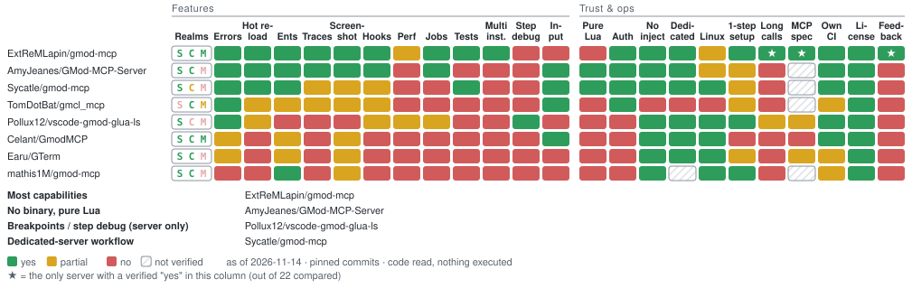

# Garry's Mod MCP servers compared

As of 2026-11-14, pinned commits, code read, nothing executed.

<picture>
  <source media="(prefers-color-scheme: dark)" srcset="comparison/comparison-dark.svg">
  
</picture>

<!-- comparison:start -->
| Repo | Realms | Errors | Hot reload | Ents | Traces | Screenshot | Hooks | Perf | Jobs | Tests | Multi-inst. | Debugger | Input | Pure Lua | Auth | No inject | Dedicated | Linux | 1-step install | Long calls | MCP spec | Own CI | License | Agent feedback |
|---|:-:|:-:|:-:|:-:|:-:|:-:|:-:|:-:|:-:|:-:|:-:|:-:|:-:|:-:|:-:|:-:|:-:|:-:|:-:|:-:|:-:|:-:|:-:|:-:|
| [ExtReMLapin/gmod-mcp](https://github.com/ExtReMLapin/gmod-mcp) | S[✅](https://github.com/ExtReMLapin/gmod-mcp/blob/8c97c40ece7ac06ec60a6821858336de8b2d8d9b/src/tools_core.cpp#L22) C[✅](https://github.com/ExtReMLapin/gmod-mcp/blob/8c97c40ece7ac06ec60a6821858336de8b2d8d9b/src/tools_core.cpp#L22) M[✅](https://github.com/ExtReMLapin/gmod-mcp/blob/8c97c40ece7ac06ec60a6821858336de8b2d8d9b/src/tools_core.cpp#L22) | [✅](https://github.com/ExtReMLapin/gmod-mcp/blob/8c97c40ece7ac06ec60a6821858336de8b2d8d9b/src/tools_console.cpp#L413) | [✅](https://github.com/ExtReMLapin/gmod-mcp/blob/8c97c40ece7ac06ec60a6821858336de8b2d8d9b/src/tools_core.cpp#L614) | [✅](https://github.com/ExtReMLapin/gmod-mcp/blob/8c97c40ece7ac06ec60a6821858336de8b2d8d9b/src/tools_world.cpp#L108) | [✅](https://github.com/ExtReMLapin/gmod-mcp/blob/8c97c40ece7ac06ec60a6821858336de8b2d8d9b/src/tools_world.cpp#L207) | [✅](https://github.com/ExtReMLapin/gmod-mcp/blob/8c97c40ece7ac06ec60a6821858336de8b2d8d9b/src/tools_world.cpp#L249) | [✅](https://github.com/ExtReMLapin/gmod-mcp/blob/8c97c40ece7ac06ec60a6821858336de8b2d8d9b/src/tools_lua.cpp#L122) | [🟡](https://github.com/ExtReMLapin/gmod-mcp/blob/8c97c40ece7ac06ec60a6821858336de8b2d8d9b/src/tools_world.cpp#L329) | [✅](https://github.com/ExtReMLapin/gmod-mcp/blob/8c97c40ece7ac06ec60a6821858336de8b2d8d9b/src/tools_jobs.cpp#L212) | [✅](https://github.com/ExtReMLapin/gmod-mcp/blob/8c97c40ece7ac06ec60a6821858336de8b2d8d9b/src/tools_lua.cpp#L155) | [✅](https://github.com/ExtReMLapin/gmod-mcp/blob/8c97c40ece7ac06ec60a6821858336de8b2d8d9b/src/tools_instances.cpp#L9) | [❌](https://github.com/ExtReMLapin/gmod-mcp/blob/8c97c40ece7ac06ec60a6821858336de8b2d8d9b/README.md#L164-L180) | [❌](https://github.com/ExtReMLapin/gmod-mcp/blob/8c97c40ece7ac06ec60a6821858336de8b2d8d9b/README.md#L164-L180) | [❌](https://github.com/ExtReMLapin/gmod-mcp/blob/8c97c40ece7ac06ec60a6821858336de8b2d8d9b/README.md#L33) | [✅](https://github.com/ExtReMLapin/gmod-mcp/blob/8c97c40ece7ac06ec60a6821858336de8b2d8d9b/src/http_server.cpp#L190-L196) | [✅](https://github.com/ExtReMLapin/gmod-mcp/blob/8c97c40ece7ac06ec60a6821858336de8b2d8d9b/src/installer.cpp#L22) | [✅](https://github.com/ExtReMLapin/gmod-mcp/blob/8c97c40ece7ac06ec60a6821858336de8b2d8d9b/src/module.cpp#L106-L108) | [✅](https://github.com/ExtReMLapin/gmod-mcp/blob/8c97c40ece7ac06ec60a6821858336de8b2d8d9b/.github/workflows/build.yml#L21-L22) | [✅](https://github.com/ExtReMLapin/gmod-mcp/blob/8c97c40ece7ac06ec60a6821858336de8b2d8d9b/README.md#L136-L137) | [✅](https://github.com/ExtReMLapin/gmod-mcp/blob/8c97c40ece7ac06ec60a6821858336de8b2d8d9b/src/mcp.cpp#L297-L298) ★ | [✅](https://github.com/ExtReMLapin/gmod-mcp/blob/8c97c40ece7ac06ec60a6821858336de8b2d8d9b/src/mcp_protocol.h#L10) ★ | [✅](https://github.com/ExtReMLapin/gmod-mcp/blob/8c97c40ece7ac06ec60a6821858336de8b2d8d9b/.github/workflows/build.yml#L40-L69) | [✅](https://github.com/ExtReMLapin/gmod-mcp/blob/8c97c40ece7ac06ec60a6821858336de8b2d8d9b/LICENSE#L1) | [✅](https://github.com/ExtReMLapin/gmod-mcp/blob/8c97c40ece7ac06ec60a6821858336de8b2d8d9b/plugin/.claude-plugin/plugin.json#L19-L22) ★ |
| [AmyJeanes/GMod-MCP-Server](https://github.com/AmyJeanes/GMod-MCP-Server) | S[✅](https://github.com/AmyJeanes/GMod-MCP-Server/blob/d06e1faa990e6b5cb4de3abb05547385e117092a/README.md#L108) C[✅](https://github.com/AmyJeanes/GMod-MCP-Server/blob/d06e1faa990e6b5cb4de3abb05547385e117092a/README.md#L107) M[❌](https://github.com/AmyJeanes/GMod-MCP-Server/blob/d06e1faa990e6b5cb4de3abb05547385e117092a/README.md#L57) | [✅](https://github.com/AmyJeanes/GMod-MCP-Server/blob/d06e1faa990e6b5cb4de3abb05547385e117092a/lua/mcp/libraries/sh_capture.lua#L145) | [✅](https://github.com/AmyJeanes/GMod-MCP-Server/blob/d06e1faa990e6b5cb4de3abb05547385e117092a/lua/mcp/functions/sh_reload_file.lua#L33) | [✅](https://github.com/AmyJeanes/GMod-MCP-Server/blob/d06e1faa990e6b5cb4de3abb05547385e117092a/README.md#L85-L86) | [✅](https://github.com/AmyJeanes/GMod-MCP-Server/blob/d06e1faa990e6b5cb4de3abb05547385e117092a/lua/mcp/functions/sh_world_trace.lua#L124) | [✅](https://github.com/AmyJeanes/GMod-MCP-Server/blob/d06e1faa990e6b5cb4de3abb05547385e117092a/lua/mcp/functions/cl_screenshot.lua#L143) | [✅](https://github.com/AmyJeanes/GMod-MCP-Server/blob/d06e1faa990e6b5cb4de3abb05547385e117092a/lua/mcp/functions/sh_debug_record.lua#L25) | [❌](https://github.com/AmyJeanes/GMod-MCP-Server/blob/d06e1faa990e6b5cb4de3abb05547385e117092a/README.md#L34) | [✅](https://github.com/AmyJeanes/GMod-MCP-Server/blob/d06e1faa990e6b5cb4de3abb05547385e117092a/lua/mcp/libraries/libraries/sh_jobs.lua#L1-L3) | [❌](https://github.com/AmyJeanes/GMod-MCP-Server/blob/d06e1faa990e6b5cb4de3abb05547385e117092a/README.md#L34) | [❌](https://github.com/AmyJeanes/GMod-MCP-Server/blob/d06e1faa990e6b5cb4de3abb05547385e117092a/README.md#L34) | [❌](https://github.com/AmyJeanes/GMod-MCP-Server/blob/d06e1faa990e6b5cb4de3abb05547385e117092a/README.md#L34) | [✅](https://github.com/AmyJeanes/GMod-MCP-Server/blob/d06e1faa990e6b5cb4de3abb05547385e117092a/lua/mcp/functions/sh_player_walk.lua#L93) | [✅](https://github.com/AmyJeanes/GMod-MCP-Server/blob/d06e1faa990e6b5cb4de3abb05547385e117092a/README.md#L28) | [✅](https://github.com/AmyJeanes/GMod-MCP-Server/blob/d06e1faa990e6b5cb4de3abb05547385e117092a/README.md#L28) | [✅](https://github.com/AmyJeanes/GMod-MCP-Server/blob/d06e1faa990e6b5cb4de3abb05547385e117092a/README.md#L28) | [✅](https://github.com/AmyJeanes/GMod-MCP-Server/blob/d06e1faa990e6b5cb4de3abb05547385e117092a/lua/mcp/libraries/sv_launch_intent.lua#L48) | [🟡](https://github.com/AmyJeanes/GMod-MCP-Server/blob/d06e1faa990e6b5cb4de3abb05547385e117092a/server/GModMcpServer/Host/GameProcessManager.cs#L68) | [🟡](https://github.com/AmyJeanes/GMod-MCP-Server/blob/d06e1faa990e6b5cb4de3abb05547385e117092a/README.md#L9-L21) | ❔ | ❔ | [✅](https://github.com/AmyJeanes/GMod-MCP-Server/blob/d06e1faa990e6b5cb4de3abb05547385e117092a/.github/workflows/ci.yml#L63) | [✅](https://github.com/AmyJeanes/GMod-MCP-Server/blob/d06e1faa990e6b5cb4de3abb05547385e117092a/LICENSE#L1) | [❌](https://github.com/AmyJeanes/GMod-MCP-Server/blob/d06e1faa990e6b5cb4de3abb05547385e117092a/README.md#L34) |
| [Sycatle/gmod-mcp](https://github.com/Sycatle/gmod-mcp) | S[✅](https://github.com/Sycatle/gmod-mcp/blob/c96d79b0ebaa3db8052bd43a51e1a00bec996c18/optional/gmod_mcp_runlua/lua/autorun/server/gmod_mcp_runlua.lua#L25) C[🟡](https://github.com/Sycatle/gmod-mcp/blob/c96d79b0ebaa3db8052bd43a51e1a00bec996c18/src/tools/bridge.ts#L285) M[❌](https://github.com/Sycatle/gmod-mcp/blob/c96d79b0ebaa3db8052bd43a51e1a00bec996c18/src/bridge/filebridge.ts#L14) | [✅](https://github.com/Sycatle/gmod-mcp/blob/c96d79b0ebaa3db8052bd43a51e1a00bec996c18/addon/gmod_mcp_bridge/lua/gmod_mcp_bridge/server/sv_errors.lua#L4) | [✅](https://github.com/Sycatle/gmod-mcp/blob/c96d79b0ebaa3db8052bd43a51e1a00bec996c18/src/proc/reload.ts#L7) | [✅](https://github.com/Sycatle/gmod-mcp/blob/c96d79b0ebaa3db8052bd43a51e1a00bec996c18/src/tools/bridge.ts#L112) | [🟡](https://github.com/Sycatle/gmod-mcp/blob/c96d79b0ebaa3db8052bd43a51e1a00bec996c18/addon/gmod_mcp_bridge/lua/autorun/client/gmod_mcp_bridge_cl.lua#L513) | [🟡](https://github.com/Sycatle/gmod-mcp/blob/c96d79b0ebaa3db8052bd43a51e1a00bec996c18/addon/gmod_mcp_bridge/lua/autorun/client/gmod_mcp_bridge_cl.lua#L421) | [🟡](https://github.com/Sycatle/gmod-mcp/blob/c96d79b0ebaa3db8052bd43a51e1a00bec996c18/addon/gmod_mcp_bridge/lua/gmod_mcp_bridge/server/sv_handlers.lua#L97) | [❌](https://github.com/Sycatle/gmod-mcp/blob/c96d79b0ebaa3db8052bd43a51e1a00bec996c18/src/tools/bridge.ts#L97) | [❌](https://github.com/Sycatle/gmod-mcp/blob/c96d79b0ebaa3db8052bd43a51e1a00bec996c18/src/tools/bridge.ts#L97) | [✅](https://github.com/Sycatle/gmod-mcp/blob/c96d79b0ebaa3db8052bd43a51e1a00bec996c18/addon/gmod_mcp_bridge/lua/gmod_mcp_bridge/server/sv_test.lua#L38) | [❌](https://github.com/Sycatle/gmod-mcp/blob/c96d79b0ebaa3db8052bd43a51e1a00bec996c18/README.md#L53) | [❌](https://github.com/Sycatle/gmod-mcp/blob/c96d79b0ebaa3db8052bd43a51e1a00bec996c18/src/tools/bridge.ts#L97) | [✅](https://github.com/Sycatle/gmod-mcp/blob/c96d79b0ebaa3db8052bd43a51e1a00bec996c18/addon/gmod_mcp_bridge/lua/autorun/client/gmod_mcp_bridge_input.lua#L107) | [✅](https://github.com/Sycatle/gmod-mcp/blob/c96d79b0ebaa3db8052bd43a51e1a00bec996c18/README.md#L10-L11) | [✅](https://github.com/Sycatle/gmod-mcp/blob/c96d79b0ebaa3db8052bd43a51e1a00bec996c18/README.md#L50-L51) | [✅](https://github.com/Sycatle/gmod-mcp/blob/c96d79b0ebaa3db8052bd43a51e1a00bec996c18/README.md#L10-L11) | [✅](https://github.com/Sycatle/gmod-mcp/blob/c96d79b0ebaa3db8052bd43a51e1a00bec996c18/README.md#L38) | [✅](https://github.com/Sycatle/gmod-mcp/blob/c96d79b0ebaa3db8052bd43a51e1a00bec996c18/src/proc/scripts.ts#L54) | [🟡](https://github.com/Sycatle/gmod-mcp/blob/c96d79b0ebaa3db8052bd43a51e1a00bec996c18/README.md#L25-L29) | [❌](https://github.com/Sycatle/gmod-mcp/blob/c96d79b0ebaa3db8052bd43a51e1a00bec996c18/src/bridge/filebridge.ts#L90) | ❔ | [✅](https://github.com/Sycatle/gmod-mcp/blob/c96d79b0ebaa3db8052bd43a51e1a00bec996c18/.github/workflows/ci.yml#L35) | [✅](https://github.com/Sycatle/gmod-mcp/blob/c96d79b0ebaa3db8052bd43a51e1a00bec996c18/LICENSE#L1) | [❌](https://github.com/Sycatle/gmod-mcp/blob/c96d79b0ebaa3db8052bd43a51e1a00bec996c18/src/tools/bridge.ts#L97) |
| [TomDotBat/gmcl_mcp](https://github.com/TomDotBat/gmcl_mcp) | S[❌](https://github.com/TomDotBat/gmcl_mcp/blob/1407d619911508bc45a4fae6b9f962cd44cbc16a/server/src/index.ts#L142) C[✅](https://github.com/TomDotBat/gmcl_mcp/blob/1407d619911508bc45a4fae6b9f962cd44cbc16a/server/src/index.ts#L142) M[🟡](https://github.com/TomDotBat/gmcl_mcp/blob/1407d619911508bc45a4fae6b9f962cd44cbc16a/core/src/lua_bridge.cpp#L83-L85) | [✅](https://github.com/TomDotBat/gmcl_mcp/blob/1407d619911508bc45a4fae6b9f962cd44cbc16a/server/src/index.ts#L194) | [🟡](https://github.com/TomDotBat/gmcl_mcp/blob/1407d619911508bc45a4fae6b9f962cd44cbc16a/server/src/index.ts#L126) | [🟡](https://github.com/TomDotBat/gmcl_mcp/blob/1407d619911508bc45a4fae6b9f962cd44cbc16a/server/src/index.ts#L152) | [🟡](https://github.com/TomDotBat/gmcl_mcp/blob/1407d619911508bc45a4fae6b9f962cd44cbc16a/server/src/index.ts#L152) | [🟡](https://github.com/TomDotBat/gmcl_mcp/blob/1407d619911508bc45a4fae6b9f962cd44cbc16a/server/src/index.ts#L234) | [🟡](https://github.com/TomDotBat/gmcl_mcp/blob/1407d619911508bc45a4fae6b9f962cd44cbc16a/server/src/waitFor.ts#L45) | [❌](https://github.com/TomDotBat/gmcl_mcp/blob/1407d619911508bc45a4fae6b9f962cd44cbc16a/README.md#L128) | [❌](https://github.com/TomDotBat/gmcl_mcp/blob/1407d619911508bc45a4fae6b9f962cd44cbc16a/README.md#L128) | [❌](https://github.com/TomDotBat/gmcl_mcp/blob/1407d619911508bc45a4fae6b9f962cd44cbc16a/README.md#L128) | [❌](https://github.com/TomDotBat/gmcl_mcp/blob/1407d619911508bc45a4fae6b9f962cd44cbc16a/README.md#L128) | [❌](https://github.com/TomDotBat/gmcl_mcp/blob/1407d619911508bc45a4fae6b9f962cd44cbc16a/README.md#L128) | [✅](https://github.com/TomDotBat/gmcl_mcp/blob/1407d619911508bc45a4fae6b9f962cd44cbc16a/README.md#L14) | [❌](https://github.com/TomDotBat/gmcl_mcp/blob/1407d619911508bc45a4fae6b9f962cd44cbc16a/README.md#L8) | [✅](https://github.com/TomDotBat/gmcl_mcp/blob/1407d619911508bc45a4fae6b9f962cd44cbc16a/core/src/ipc_server.cpp#L106-L109) | [❌](https://github.com/TomDotBat/gmcl_mcp/blob/1407d619911508bc45a4fae6b9f962cd44cbc16a/README.md#L31) | [❌](https://github.com/TomDotBat/gmcl_mcp/blob/1407d619911508bc45a4fae6b9f962cd44cbc16a/README.md#L21) | [❌](https://github.com/TomDotBat/gmcl_mcp/blob/1407d619911508bc45a4fae6b9f962cd44cbc16a/README.md#L52) | [🟡](https://github.com/TomDotBat/gmcl_mcp/blob/1407d619911508bc45a4fae6b9f962cd44cbc16a/README.md#L50-L75) | [❌](https://github.com/TomDotBat/gmcl_mcp/blob/1407d619911508bc45a4fae6b9f962cd44cbc16a/server/src/ipc.ts#L94) | ❔ | [🟡](https://github.com/TomDotBat/gmcl_mcp/blob/1407d619911508bc45a4fae6b9f962cd44cbc16a/.github/workflows/build.yml#L42) | [✅](https://github.com/TomDotBat/gmcl_mcp/blob/1407d619911508bc45a4fae6b9f962cd44cbc16a/LICENSE#L1) | [❌](https://github.com/TomDotBat/gmcl_mcp/blob/1407d619911508bc45a4fae6b9f962cd44cbc16a/README.md#L128) |
| [Pollux12/vscode-gmod-glua-ls](https://github.com/Pollux12/vscode-gmod-glua-ls) | S[✅](https://github.com/Pollux12/vscode-gmod-glua-ls/blob/20c00690081f72dc2f0ebbf5f9e575ba95182c51/src/mcp/runtimeTools.ts#L316) C[❌](https://github.com/Pollux12/vscode-gmod-glua-ls/blob/20c00690081f72dc2f0ebbf5f9e575ba95182c51/README.md#L133) M[❌](https://github.com/Pollux12/vscode-gmod-glua-ls/blob/20c00690081f72dc2f0ebbf5f9e575ba95182c51/README.md#L133) | [✅](https://github.com/Pollux12/vscode-gmod-glua-ls/blob/20c00690081f72dc2f0ebbf5f9e575ba95182c51/src/mcp/logTools.ts#L172) | [🟡](https://github.com/Pollux12/vscode-gmod-glua-ls/blob/20c00690081f72dc2f0ebbf5f9e575ba95182c51/src/mcp/runtimeTools.ts#L321) | [❌](https://github.com/Pollux12/vscode-gmod-glua-ls/blob/20c00690081f72dc2f0ebbf5f9e575ba95182c51/README.md#L133) | [❌](https://github.com/Pollux12/vscode-gmod-glua-ls/blob/20c00690081f72dc2f0ebbf5f9e575ba95182c51/README.md#L133) | [❌](https://github.com/Pollux12/vscode-gmod-glua-ls/blob/20c00690081f72dc2f0ebbf5f9e575ba95182c51/README.md#L133) | [🟡](https://github.com/Pollux12/vscode-gmod-glua-ls/blob/20c00690081f72dc2f0ebbf5f9e575ba95182c51/src/mcp/runtimeTools.ts#L779) | [🟡](https://github.com/Pollux12/vscode-gmod-glua-ls/blob/20c00690081f72dc2f0ebbf5f9e575ba95182c51/src/mcp/runtimeTools.ts#L779) | [🟡](https://github.com/Pollux12/vscode-gmod-glua-ls/blob/20c00690081f72dc2f0ebbf5f9e575ba95182c51/src/mcp/runtimeTools.ts#L392) | [❌](https://github.com/Pollux12/vscode-gmod-glua-ls/blob/20c00690081f72dc2f0ebbf5f9e575ba95182c51/README.md#L133) | [❌](https://github.com/Pollux12/vscode-gmod-glua-ls/blob/20c00690081f72dc2f0ebbf5f9e575ba95182c51/README.md#L133) | [✅](https://github.com/Pollux12/vscode-gmod-glua-ls/blob/20c00690081f72dc2f0ebbf5f9e575ba95182c51/src/mcp/runtimeTools.ts#L458) | [❌](https://github.com/Pollux12/vscode-gmod-glua-ls/blob/20c00690081f72dc2f0ebbf5f9e575ba95182c51/README.md#L133) | [❌](https://github.com/Pollux12/vscode-gmod-glua-ls/blob/20c00690081f72dc2f0ebbf5f9e575ba95182c51/README.md#L155) | [❌](https://github.com/Pollux12/gmod-glua-ls/blob/5297904d82194db0cefcc29c86b4cdbb82c3ba05/docs/mintlify/debugger/ai-agents.mdx#L31) | [✅](https://github.com/Pollux12/vscode-gmod-glua-ls/blob/20c00690081f72dc2f0ebbf5f9e575ba95182c51/README.md#L155) | [✅](https://github.com/Pollux12/vscode-gmod-glua-ls/blob/20c00690081f72dc2f0ebbf5f9e575ba95182c51/README.md#L155) | [✅](https://github.com/Pollux12/vscode-gmod-glua-ls/blob/20c00690081f72dc2f0ebbf5f9e575ba95182c51/src/debugger/gmod_debugger/GmodDebugSetupWizard.ts#L28) | [✅](https://github.com/Pollux12/vscode-gmod-glua-ls/blob/20c00690081f72dc2f0ebbf5f9e575ba95182c51/README.md#L145) | [🟡](https://github.com/Pollux12/vscode-gmod-glua-ls/blob/20c00690081f72dc2f0ebbf5f9e575ba95182c51/src/mcp/runtimeTools.ts#L342) | [🟡](https://github.com/Pollux12/vscode-gmod-glua-ls/blob/20c00690081f72dc2f0ebbf5f9e575ba95182c51/src/mcp/mcpHttpServer.ts#L13) | [✅](https://github.com/Pollux12/vscode-gmod-glua-ls/blob/20c00690081f72dc2f0ebbf5f9e575ba95182c51/.github/workflows/tests.yml#L49) | [✅](https://github.com/Pollux12/vscode-gmod-glua-ls/blob/20c00690081f72dc2f0ebbf5f9e575ba95182c51/LICENSE#L1) | [❌](https://github.com/Pollux12/vscode-gmod-glua-ls/blob/20c00690081f72dc2f0ebbf5f9e575ba95182c51/README.md#L133) |
| [Celant/GmodMCP](https://github.com/Celant/GmodMCP) | S[✅](https://github.com/Celant/GmodMCP/blob/ba6a5963954fee88ed4c0fe79e93ac37554a2e47/module/lua/gmodmcp/tools/console.lua#L48) C[✅](https://github.com/Celant/GmodMCP/blob/ba6a5963954fee88ed4c0fe79e93ac37554a2e47/module/lua/gmodmcp/tools/console.lua#L48) M[✅](https://github.com/Celant/GmodMCP/blob/ba6a5963954fee88ed4c0fe79e93ac37554a2e47/README.md#L55) | [🟡](https://github.com/Celant/GmodMCP/blob/ba6a5963954fee88ed4c0fe79e93ac37554a2e47/README.md#L98) | [❌](https://github.com/Celant/GmodMCP/blob/ba6a5963954fee88ed4c0fe79e93ac37554a2e47/README.md#L92-L104) | [🟡](https://github.com/Celant/GmodMCP/blob/ba6a5963954fee88ed4c0fe79e93ac37554a2e47/README.md#L96) | [❌](https://github.com/Celant/GmodMCP/blob/ba6a5963954fee88ed4c0fe79e93ac37554a2e47/README.md#L92-L104) | [🟡](https://github.com/Celant/GmodMCP/blob/ba6a5963954fee88ed4c0fe79e93ac37554a2e47/README.md#L102) | [❌](https://github.com/Celant/GmodMCP/blob/ba6a5963954fee88ed4c0fe79e93ac37554a2e47/README.md#L92-L104) | [❌](https://github.com/Celant/GmodMCP/blob/ba6a5963954fee88ed4c0fe79e93ac37554a2e47/README.md#L92-L104) | [❌](https://github.com/Celant/GmodMCP/blob/ba6a5963954fee88ed4c0fe79e93ac37554a2e47/README.md#L92-L104) | [❌](https://github.com/Celant/GmodMCP/blob/ba6a5963954fee88ed4c0fe79e93ac37554a2e47/README.md#L92-L104) | [❌](https://github.com/Celant/GmodMCP/blob/ba6a5963954fee88ed4c0fe79e93ac37554a2e47/README.md#L92-L104) | [❌](https://github.com/Celant/GmodMCP/blob/ba6a5963954fee88ed4c0fe79e93ac37554a2e47/README.md#L92-L104) | [✅](https://github.com/Celant/GmodMCP/blob/ba6a5963954fee88ed4c0fe79e93ac37554a2e47/module/lua/gmodmcp/tools/input.lua#L8) | [❌](https://github.com/Celant/GmodMCP/blob/ba6a5963954fee88ed4c0fe79e93ac37554a2e47/README.md#L30) | [❌](https://github.com/Celant/GmodMCP/blob/ba6a5963954fee88ed4c0fe79e93ac37554a2e47/module/lua/gmodmcp/core/mcp.lua#L24) | [✅](https://github.com/Celant/GmodMCP/blob/ba6a5963954fee88ed4c0fe79e93ac37554a2e47/README.md#L38) | [✅](https://github.com/Celant/GmodMCP/blob/ba6a5963954fee88ed4c0fe79e93ac37554a2e47/README.md#L36) | [✅](https://github.com/Celant/GmodMCP/blob/ba6a5963954fee88ed4c0fe79e93ac37554a2e47/README.md#L38) | [❌](https://github.com/Celant/GmodMCP/blob/ba6a5963954fee88ed4c0fe79e93ac37554a2e47/README.md#L30-L31) | [❌](https://github.com/Celant/GmodMCP/blob/ba6a5963954fee88ed4c0fe79e93ac37554a2e47/module/lua/gmodmcp/tools/console.lua#L53) | [❌](https://github.com/Celant/GmodMCP/blob/ba6a5963954fee88ed4c0fe79e93ac37554a2e47/module/lua/gmodmcp/core/mcp.lua#L4) | [✅](https://github.com/Celant/GmodMCP/blob/ba6a5963954fee88ed4c0fe79e93ac37554a2e47/.github/workflows/build.yml#L24) | [✅](https://github.com/Celant/GmodMCP/blob/ba6a5963954fee88ed4c0fe79e93ac37554a2e47/LICENSE#L1) | [❌](https://github.com/Celant/GmodMCP/blob/ba6a5963954fee88ed4c0fe79e93ac37554a2e47/README.md#L92-L104) |
| [Earu/GTerm](https://github.com/Earu/GTerm) | S[✅](https://github.com/Earu/GTerm/blob/aa6453425ac319e93c8ec7f20926b5371781ad31/MCP/LuaExecutor.cs#L6-L10) C[✅](https://github.com/Earu/GTerm/blob/aa6453425ac319e93c8ec7f20926b5371781ad31/MCP/LuaExecutor.cs#L6-L10) M[❌](https://github.com/Earu/GTerm/blob/aa6453425ac319e93c8ec7f20926b5371781ad31/MCP/MCPServer.cs#L436) | [🟡](https://github.com/Earu/GTerm/blob/aa6453425ac319e93c8ec7f20926b5371781ad31/MCP/MCPServer.cs#L635) | [❌](https://github.com/Earu/GTerm/blob/aa6453425ac319e93c8ec7f20926b5371781ad31/MCP/MCPServer.cs#L492) | [🟡](https://github.com/Earu/GTerm/blob/aa6453425ac319e93c8ec7f20926b5371781ad31/MCP/MCPServer.cs#L492) | [❌](https://github.com/Earu/GTerm/blob/aa6453425ac319e93c8ec7f20926b5371781ad31/MCP/MCPServer.cs#L492) | [🟡](https://github.com/Earu/GTerm/blob/aa6453425ac319e93c8ec7f20926b5371781ad31/MCP/MCPServer.cs#L793) | [❌](https://github.com/Earu/GTerm/blob/aa6453425ac319e93c8ec7f20926b5371781ad31/MCP/MCPServer.cs#L492) | [❌](https://github.com/Earu/GTerm/blob/aa6453425ac319e93c8ec7f20926b5371781ad31/MCP/MCPServer.cs#L492) | [❌](https://github.com/Earu/GTerm/blob/aa6453425ac319e93c8ec7f20926b5371781ad31/MCP/MCPServer.cs#L492) | [❌](https://github.com/Earu/GTerm/blob/aa6453425ac319e93c8ec7f20926b5371781ad31/MCP/MCPServer.cs#L492) | [❌](https://github.com/Earu/GTerm/blob/aa6453425ac319e93c8ec7f20926b5371781ad31/MCP/MCPServer.cs#L492) | [❌](https://github.com/Earu/GTerm/blob/aa6453425ac319e93c8ec7f20926b5371781ad31/MCP/MCPServer.cs#L492) | [❌](https://github.com/Earu/GTerm/blob/aa6453425ac319e93c8ec7f20926b5371781ad31/MCP/MCPServer.cs#L492) | [❌](https://github.com/Earu/GTerm/blob/aa6453425ac319e93c8ec7f20926b5371781ad31/README.md#L15) | [❌](https://github.com/Earu/GTerm/blob/aa6453425ac319e93c8ec7f20926b5371781ad31/MCP/MCPServer.cs#L151) | [✅](https://github.com/Earu/GTerm/blob/aa6453425ac319e93c8ec7f20926b5371781ad31/README.md#L31) | [✅](https://github.com/Earu/GTerm/blob/aa6453425ac319e93c8ec7f20926b5371781ad31/README.md#L13) | [✅](https://github.com/Earu/GTerm/blob/aa6453425ac319e93c8ec7f20926b5371781ad31/README.md#L15) | [🟡](https://github.com/Earu/GTerm/blob/aa6453425ac319e93c8ec7f20926b5371781ad31/README.md#L7-L10) | [❌](https://github.com/Earu/GTerm/blob/aa6453425ac319e93c8ec7f20926b5371781ad31/MCP/MCPServer.cs#L1269) | [🟡](https://github.com/Earu/GTerm/blob/aa6453425ac319e93c8ec7f20926b5371781ad31/MCP/MCPServer.cs#L16-L19) | [🟡](https://github.com/Earu/GTerm/blob/aa6453425ac319e93c8ec7f20926b5371781ad31/.github/workflows/build.yml#L48) | [✅](https://github.com/Earu/GTerm/blob/aa6453425ac319e93c8ec7f20926b5371781ad31/LICENSE#L1) | [❌](https://github.com/Earu/GTerm/blob/aa6453425ac319e93c8ec7f20926b5371781ad31/MCP/MCPServer.cs#L492) |
| [mathis1M/gmod-mcp](https://github.com/mathis1M/gmod-mcp) | S[✅](https://github.com/mathis1M/gmod-mcp/blob/487f8d235ab3b5369a5634d116e933f6e1663e8f/mcp/server.ts#L273) C[✅](https://github.com/mathis1M/gmod-mcp/blob/487f8d235ab3b5369a5634d116e933f6e1663e8f/mcp/server.ts#L273) M[❌](https://github.com/mathis1M/gmod-mcp/blob/487f8d235ab3b5369a5634d116e933f6e1663e8f/mcp/server.ts#L273) | [❌](https://github.com/mathis1M/gmod-mcp/blob/487f8d235ab3b5369a5634d116e933f6e1663e8f/mcp/server.ts#L165) | [❌](https://github.com/mathis1M/gmod-mcp/blob/487f8d235ab3b5369a5634d116e933f6e1663e8f/mcp/server.ts#L165) | [✅](https://github.com/mathis1M/gmod-mcp/blob/487f8d235ab3b5369a5634d116e933f6e1663e8f/mcp/server.ts#L213) | [❌](https://github.com/mathis1M/gmod-mcp/blob/487f8d235ab3b5369a5634d116e933f6e1663e8f/mcp/server.ts#L165) | [🟡](https://github.com/mathis1M/gmod-mcp/blob/487f8d235ab3b5369a5634d116e933f6e1663e8f/addon/gmod_mcp/lua/gmod_mcp/client/tools/screenshot.lua#L50) | [❌](https://github.com/mathis1M/gmod-mcp/blob/487f8d235ab3b5369a5634d116e933f6e1663e8f/mcp/server.ts#L165) | [❌](https://github.com/mathis1M/gmod-mcp/blob/487f8d235ab3b5369a5634d116e933f6e1663e8f/mcp/server.ts#L165) | [❌](https://github.com/mathis1M/gmod-mcp/blob/487f8d235ab3b5369a5634d116e933f6e1663e8f/mcp/server.ts#L165) | [❌](https://github.com/mathis1M/gmod-mcp/blob/487f8d235ab3b5369a5634d116e933f6e1663e8f/mcp/server.ts#L165) | [❌](https://github.com/mathis1M/gmod-mcp/blob/487f8d235ab3b5369a5634d116e933f6e1663e8f/mcp/server.ts#L165) | [❌](https://github.com/mathis1M/gmod-mcp/blob/487f8d235ab3b5369a5634d116e933f6e1663e8f/mcp/server.ts#L165) | [❌](https://github.com/mathis1M/gmod-mcp/blob/487f8d235ab3b5369a5634d116e933f6e1663e8f/mcp/server.ts#L165) | [❌](https://github.com/mathis1M/gmod-mcp/blob/487f8d235ab3b5369a5634d116e933f6e1663e8f/bridge/src/lib.rs#L14) | [❌](https://github.com/mathis1M/gmod-mcp/blob/487f8d235ab3b5369a5634d116e933f6e1663e8f/bridge/src/lib.rs#L17) | [✅](https://github.com/mathis1M/gmod-mcp/blob/487f8d235ab3b5369a5634d116e933f6e1663e8f/README.md#L90) | ❔ | [✅](https://github.com/mathis1M/gmod-mcp/blob/487f8d235ab3b5369a5634d116e933f6e1663e8f/README.md#L72) | [✅](https://github.com/mathis1M/gmod-mcp/blob/487f8d235ab3b5369a5634d116e933f6e1663e8f/README.md#L88-L91) | [❌](https://github.com/mathis1M/gmod-mcp/blob/487f8d235ab3b5369a5634d116e933f6e1663e8f/bridge/src/lib.rs#L28) | ❔ | [🟡](https://github.com/mathis1M/gmod-mcp/blob/487f8d235ab3b5369a5634d116e933f6e1663e8f/.github/workflows/publish.yml#L37) | [✅](https://github.com/mathis1M/gmod-mcp/blob/487f8d235ab3b5369a5634d116e933f6e1663e8f/LICENSE#L1) | [❌](https://github.com/mathis1M/gmod-mcp/blob/487f8d235ab3b5369a5634d116e933f6e1663e8f/mcp/server.ts#L165) |
| [unknown-gd/gm_mcp](https://github.com/unknown-gd/gm_mcp) | S[🟡](https://github.com/unknown-gd/gm_mcp/blob/900947618be235db8392767aff7d0d5363938efe/README.md#L17) C[🟡](https://github.com/unknown-gd/gm_mcp/blob/900947618be235db8392767aff7d0d5363938efe/README.md#L17) M[❌](https://github.com/unknown-gd/gm_mcp/blob/900947618be235db8392767aff7d0d5363938efe/mcp/server.ts#L139) | [❌](https://github.com/unknown-gd/gm_mcp/blob/900947618be235db8392767aff7d0d5363938efe/mcp/server.ts#L139) | [❌](https://github.com/unknown-gd/gm_mcp/blob/900947618be235db8392767aff7d0d5363938efe/mcp/server.ts#L139) | [🟡](https://github.com/unknown-gd/gm_mcp/blob/900947618be235db8392767aff7d0d5363938efe/README.md#L17) | [❌](https://github.com/unknown-gd/gm_mcp/blob/900947618be235db8392767aff7d0d5363938efe/mcp/server.ts#L139) | [🟡](https://github.com/unknown-gd/gm_mcp/blob/900947618be235db8392767aff7d0d5363938efe/README.md#L17) | [❌](https://github.com/unknown-gd/gm_mcp/blob/900947618be235db8392767aff7d0d5363938efe/mcp/server.ts#L139) | [❌](https://github.com/unknown-gd/gm_mcp/blob/900947618be235db8392767aff7d0d5363938efe/mcp/server.ts#L139) | [❌](https://github.com/unknown-gd/gm_mcp/blob/900947618be235db8392767aff7d0d5363938efe/mcp/server.ts#L139) | [❌](https://github.com/unknown-gd/gm_mcp/blob/900947618be235db8392767aff7d0d5363938efe/mcp/server.ts#L139) | [❌](https://github.com/unknown-gd/gm_mcp/blob/900947618be235db8392767aff7d0d5363938efe/mcp/server.ts#L139) | [❌](https://github.com/unknown-gd/gm_mcp/blob/900947618be235db8392767aff7d0d5363938efe/mcp/server.ts#L139) | [❌](https://github.com/unknown-gd/gm_mcp/blob/900947618be235db8392767aff7d0d5363938efe/mcp/server.ts#L139) | [❌](https://github.com/unknown-gd/gm_mcp/blob/900947618be235db8392767aff7d0d5363938efe/README.md#L19) | [❌](https://github.com/unknown-gd/gm_mcp/blob/900947618be235db8392767aff7d0d5363938efe/src/mcp.cpp#L288) | [✅](https://github.com/unknown-gd/gm_mcp/blob/900947618be235db8392767aff7d0d5363938efe/README.md#L19) | [🟡](https://github.com/unknown-gd/gm_mcp/blob/900947618be235db8392767aff7d0d5363938efe/README.md#L45) | [✅](https://github.com/unknown-gd/gm_mcp/blob/900947618be235db8392767aff7d0d5363938efe/README.md#L45) | [❌](https://github.com/unknown-gd/gm_mcp/blob/900947618be235db8392767aff7d0d5363938efe/README.md#L17) | [❌](https://github.com/unknown-gd/gm_mcp/blob/900947618be235db8392767aff7d0d5363938efe/src/bridge.cpp#L31) | ❔ | [🟡](https://github.com/unknown-gd/gm_mcp/blob/900947618be235db8392767aff7d0d5363938efe/.github/workflows/build.yml#L49) | [✅](https://github.com/unknown-gd/gm_mcp/blob/900947618be235db8392767aff7d0d5363938efe/LICENSE#L1) | [❌](https://github.com/unknown-gd/gm_mcp/blob/900947618be235db8392767aff7d0d5363938efe/mcp/server.ts#L139) |
| [BrownJourney/gmod-mcp](https://github.com/BrownJourney/gmod-mcp) | S[✅](https://github.com/BrownJourney/gmod-mcp/blob/cfc2c34f8ff6cfeba46cba33d8da63538f33ab28/lua/autorun/gmod_mcp.lua#L5) C[✅](https://github.com/BrownJourney/gmod-mcp/blob/cfc2c34f8ff6cfeba46cba33d8da63538f33ab28/lua/autorun/gmod_mcp.lua#L5) M[❌](https://github.com/BrownJourney/gmod-mcp/blob/cfc2c34f8ff6cfeba46cba33d8da63538f33ab28/lua/autorun/gmod_mcp.lua#L5) | [🟡](https://github.com/BrownJourney/gmod-mcp/blob/cfc2c34f8ff6cfeba46cba33d8da63538f33ab28/server/src/index.ts#L160) | [✅](https://github.com/BrownJourney/gmod-mcp/blob/cfc2c34f8ff6cfeba46cba33d8da63538f33ab28/server/src/index.ts#L206) | [❌](https://github.com/BrownJourney/gmod-mcp/blob/cfc2c34f8ff6cfeba46cba33d8da63538f33ab28/server/src/index.ts#L82-L90) | [❌](https://github.com/BrownJourney/gmod-mcp/blob/cfc2c34f8ff6cfeba46cba33d8da63538f33ab28/server/src/index.ts#L81) | [🟡](https://github.com/BrownJourney/gmod-mcp/blob/cfc2c34f8ff6cfeba46cba33d8da63538f33ab28/lua/autorun/gmod_mcp.lua#L161) | [❌](https://github.com/BrownJourney/gmod-mcp/blob/cfc2c34f8ff6cfeba46cba33d8da63538f33ab28/server/src/index.ts#L81) | [❌](https://github.com/BrownJourney/gmod-mcp/blob/cfc2c34f8ff6cfeba46cba33d8da63538f33ab28/server/src/index.ts#L81) | [❌](https://github.com/BrownJourney/gmod-mcp/blob/cfc2c34f8ff6cfeba46cba33d8da63538f33ab28/server/src/index.ts#L81) | [❌](https://github.com/BrownJourney/gmod-mcp/blob/cfc2c34f8ff6cfeba46cba33d8da63538f33ab28/server/src/index.ts#L81) | [❌](https://github.com/BrownJourney/gmod-mcp/blob/cfc2c34f8ff6cfeba46cba33d8da63538f33ab28/server/src/index.ts#L81) | [❌](https://github.com/BrownJourney/gmod-mcp/blob/cfc2c34f8ff6cfeba46cba33d8da63538f33ab28/server/src/index.ts#L81) | [❌](https://github.com/BrownJourney/gmod-mcp/blob/cfc2c34f8ff6cfeba46cba33d8da63538f33ab28/server/src/index.ts#L81) | [✅](https://github.com/BrownJourney/gmod-mcp/blob/cfc2c34f8ff6cfeba46cba33d8da63538f33ab28/lua/autorun/gmod_mcp.lua#L1) | [✅](https://github.com/BrownJourney/gmod-mcp/blob/cfc2c34f8ff6cfeba46cba33d8da63538f33ab28/lua/autorun/gmod_mcp.lua#L2) | [✅](https://github.com/BrownJourney/gmod-mcp/blob/cfc2c34f8ff6cfeba46cba33d8da63538f33ab28/lua/autorun/gmod_mcp.lua#L1) | ❔ | [✅](https://github.com/BrownJourney/gmod-mcp/blob/cfc2c34f8ff6cfeba46cba33d8da63538f33ab28/README.md#L21) | [🟡](https://github.com/BrownJourney/gmod-mcp/blob/cfc2c34f8ff6cfeba46cba33d8da63538f33ab28/README.md#L30-L31) | [❌](https://github.com/BrownJourney/gmod-mcp/blob/cfc2c34f8ff6cfeba46cba33d8da63538f33ab28/server/src/bridge.ts#L89) | ❔ | [❌](https://github.com/BrownJourney/gmod-mcp/tree/cfc2c34f8ff6cfeba46cba33d8da63538f33ab28) | [❌](https://github.com/BrownJourney/gmod-mcp/tree/cfc2c34f8ff6cfeba46cba33d8da63538f33ab28) | [❌](https://github.com/BrownJourney/gmod-mcp/blob/cfc2c34f8ff6cfeba46cba33d8da63538f33ab28/server/src/index.ts#L81) |
| [DBOYttt/gmod-mcp](https://github.com/DBOYttt/gmod-mcp) | S[✅](https://github.com/DBOYttt/gmod-mcp/blob/1d0415761495636c56852ce2a6d526acf4e16740/gr_mcp/server.py#L80) C[✅](https://github.com/DBOYttt/gmod-mcp/blob/1d0415761495636c56852ce2a6d526acf4e16740/gr_mcp/server.py#L142) M[❌](https://github.com/DBOYttt/gmod-mcp/blob/1d0415761495636c56852ce2a6d526acf4e16740/gr_mcp/server.py#L33) | [🟡](https://github.com/DBOYttt/gmod-mcp/blob/1d0415761495636c56852ce2a6d526acf4e16740/gr_mcp/server.py#L90) | [❌](https://github.com/DBOYttt/gmod-mcp/blob/1d0415761495636c56852ce2a6d526acf4e16740/gr_mcp/server.py#L61-L62) | [❌](https://github.com/DBOYttt/gmod-mcp/blob/1d0415761495636c56852ce2a6d526acf4e16740/gr_mcp/server.py#L33) | [❌](https://github.com/DBOYttt/gmod-mcp/blob/1d0415761495636c56852ce2a6d526acf4e16740/gr_mcp/server.py#L33) | [🟡](https://github.com/DBOYttt/gmod-mcp/blob/1d0415761495636c56852ce2a6d526acf4e16740/gr_mcp/server.py#L168) | [❌](https://github.com/DBOYttt/gmod-mcp/blob/1d0415761495636c56852ce2a6d526acf4e16740/gr_mcp/server.py#L33) | [❌](https://github.com/DBOYttt/gmod-mcp/blob/1d0415761495636c56852ce2a6d526acf4e16740/gr_mcp/server.py#L33) | [❌](https://github.com/DBOYttt/gmod-mcp/blob/1d0415761495636c56852ce2a6d526acf4e16740/gr_mcp/server.py#L33) | [❌](https://github.com/DBOYttt/gmod-mcp/blob/1d0415761495636c56852ce2a6d526acf4e16740/gr_mcp/server.py#L33) | [❌](https://github.com/DBOYttt/gmod-mcp/blob/1d0415761495636c56852ce2a6d526acf4e16740/gr_mcp/server.py#L33) | [❌](https://github.com/DBOYttt/gmod-mcp/blob/1d0415761495636c56852ce2a6d526acf4e16740/gr_mcp/server.py#L33) | [🟡](https://github.com/DBOYttt/gmod-mcp/blob/1d0415761495636c56852ce2a6d526acf4e16740/gr_mcp/input_controller.py#L20) | [✅](https://github.com/DBOYttt/gmod-mcp/blob/1d0415761495636c56852ce2a6d526acf4e16740/gr_mcp/client_manager.py#L81) | [✅](https://github.com/DBOYttt/gmod-mcp/blob/1d0415761495636c56852ce2a6d526acf4e16740/gr_mcp/server.py#L203) | [✅](https://github.com/DBOYttt/gmod-mcp/blob/1d0415761495636c56852ce2a6d526acf4e16740/gr_mcp/client_manager.py#L81) | [✅](https://github.com/DBOYttt/gmod-mcp/blob/1d0415761495636c56852ce2a6d526acf4e16740/gr_mcp/pty_manager.py#L40) | [✅](https://github.com/DBOYttt/gmod-mcp/blob/1d0415761495636c56852ce2a6d526acf4e16740/gr_mcp/pty_manager.py#L40) | [🟡](https://github.com/DBOYttt/gmod-mcp/blob/1d0415761495636c56852ce2a6d526acf4e16740/README.md#L8) | [❌](https://github.com/DBOYttt/gmod-mcp/blob/1d0415761495636c56852ce2a6d526acf4e16740/gr_mcp/server.py#L80) | ❔ | [❌](https://github.com/DBOYttt/gmod-mcp/tree/1d0415761495636c56852ce2a6d526acf4e16740) | [❌](https://github.com/DBOYttt/gmod-mcp/tree/1d0415761495636c56852ce2a6d526acf4e16740) | [❌](https://github.com/DBOYttt/gmod-mcp/blob/1d0415761495636c56852ce2a6d526acf4e16740/gr_mcp/server.py#L33) |
| [Shaar-games/gmod_mcp](https://github.com/Shaar-games/gmod_mcp) | S[❌](https://github.com/Shaar-games/gmod_mcp/blob/d04c71bbd27e15cf4d5800c20d4943fd27fe0151/main.go#L321) C[🟡](https://github.com/Shaar-games/gmod_mcp/blob/d04c71bbd27e15cf4d5800c20d4943fd27fe0151/main.go#L321) M[❌](https://github.com/Shaar-games/gmod_mcp/blob/d04c71bbd27e15cf4d5800c20d4943fd27fe0151/main.go#L321) | [🟡](https://github.com/Shaar-games/gmod_mcp/blob/d04c71bbd27e15cf4d5800c20d4943fd27fe0151/main.go#L323) | [❌](https://github.com/Shaar-games/gmod_mcp/blob/d04c71bbd27e15cf4d5800c20d4943fd27fe0151/main.go#L305) | [❌](https://github.com/Shaar-games/gmod_mcp/blob/d04c71bbd27e15cf4d5800c20d4943fd27fe0151/main.go#L305) | [❌](https://github.com/Shaar-games/gmod_mcp/blob/d04c71bbd27e15cf4d5800c20d4943fd27fe0151/main.go#L305) | [❌](https://github.com/Shaar-games/gmod_mcp/blob/d04c71bbd27e15cf4d5800c20d4943fd27fe0151/main.go#L305) | [❌](https://github.com/Shaar-games/gmod_mcp/blob/d04c71bbd27e15cf4d5800c20d4943fd27fe0151/main.go#L305) | [❌](https://github.com/Shaar-games/gmod_mcp/blob/d04c71bbd27e15cf4d5800c20d4943fd27fe0151/main.go#L305) | [❌](https://github.com/Shaar-games/gmod_mcp/blob/d04c71bbd27e15cf4d5800c20d4943fd27fe0151/main.go#L305) | [❌](https://github.com/Shaar-games/gmod_mcp/blob/d04c71bbd27e15cf4d5800c20d4943fd27fe0151/main.go#L305) | [🟡](https://github.com/Shaar-games/gmod_mcp/blob/d04c71bbd27e15cf4d5800c20d4943fd27fe0151/main.go#L41) | [❌](https://github.com/Shaar-games/gmod_mcp/blob/d04c71bbd27e15cf4d5800c20d4943fd27fe0151/main.go#L305) | [❌](https://github.com/Shaar-games/gmod_mcp/blob/d04c71bbd27e15cf4d5800c20d4943fd27fe0151/main.go#L305) | [❌](https://github.com/Shaar-games/gmod_mcp/blob/d04c71bbd27e15cf4d5800c20d4943fd27fe0151/internal/gmod/remote_windows.go#L68) | [✅](https://github.com/Shaar-games/gmod_mcp/blob/d04c71bbd27e15cf4d5800c20d4943fd27fe0151/main.go#L343) | [❌](https://github.com/Shaar-games/gmod_mcp/blob/d04c71bbd27e15cf4d5800c20d4943fd27fe0151/internal/gmod/remote_windows.go#L68) | [❌](https://github.com/Shaar-games/gmod_mcp/blob/d04c71bbd27e15cf4d5800c20d4943fd27fe0151/README.md#L3) | [❌](https://github.com/Shaar-games/gmod_mcp/blob/d04c71bbd27e15cf4d5800c20d4943fd27fe0151/README.md#L3) | [🟡](https://github.com/Shaar-games/gmod_mcp/blob/d04c71bbd27e15cf4d5800c20d4943fd27fe0151/README.md#L24) | [❌](https://github.com/Shaar-games/gmod_mcp/blob/d04c71bbd27e15cf4d5800c20d4943fd27fe0151/main.go#L55) | ❔ | [❌](https://github.com/Shaar-games/gmod_mcp/tree/d04c71bbd27e15cf4d5800c20d4943fd27fe0151) | [✅](https://github.com/Shaar-games/gmod_mcp/blob/d04c71bbd27e15cf4d5800c20d4943fd27fe0151/LICENSE#L1) | [❌](https://github.com/Shaar-games/gmod_mcp/blob/d04c71bbd27e15cf4d5800c20d4943fd27fe0151/main.go#L305) |
| [Avrena/srcds-mcp](https://github.com/Avrena/srcds-mcp) | S[✅](https://github.com/Avrena/srcds-mcp/blob/a6933a83a540e2a10f8a68e8f166a6e3f6620245/srcds_mcp.py#L4698) C[🟡](https://github.com/Avrena/srcds-mcp/blob/a6933a83a540e2a10f8a68e8f166a6e3f6620245/srcds_mcp.py#L4808) M[❌](https://github.com/Avrena/srcds-mcp/blob/a6933a83a540e2a10f8a68e8f166a6e3f6620245/srcds_mcp.py#L14-L17) | [✅](https://github.com/Avrena/srcds-mcp/blob/a6933a83a540e2a10f8a68e8f166a6e3f6620245/srcds_diagnostics.lua#L234) | [🟡](https://github.com/Avrena/srcds-mcp/blob/a6933a83a540e2a10f8a68e8f166a6e3f6620245/srcds_mcp.py#L4725) | [🟡](https://github.com/Avrena/srcds-mcp/blob/a6933a83a540e2a10f8a68e8f166a6e3f6620245/srcds_mcp.py#L4996) | [❌](https://github.com/Avrena/srcds-mcp/blob/a6933a83a540e2a10f8a68e8f166a6e3f6620245/srcds_mcp.py#L14-L17) | [❌](https://github.com/Avrena/srcds-mcp/blob/a6933a83a540e2a10f8a68e8f166a6e3f6620245/srcds_mcp.py#L14-L17) | [❌](https://github.com/Avrena/srcds-mcp/blob/a6933a83a540e2a10f8a68e8f166a6e3f6620245/srcds_mcp.py#L14-L17) | [🟡](https://github.com/Avrena/srcds-mcp/blob/a6933a83a540e2a10f8a68e8f166a6e3f6620245/srcds_mcp.py#L4993) | [🟡](https://github.com/Avrena/srcds-mcp/blob/a6933a83a540e2a10f8a68e8f166a6e3f6620245/srcds_mcp.py#L4717) | [🟡](https://github.com/Avrena/srcds-mcp/blob/a6933a83a540e2a10f8a68e8f166a6e3f6620245/srcds_mcp.py#L4702) | [🟡](https://github.com/Avrena/srcds-mcp/blob/a6933a83a540e2a10f8a68e8f166a6e3f6620245/srcds_mcp.py#L17) | [❌](https://github.com/Avrena/srcds-mcp/blob/a6933a83a540e2a10f8a68e8f166a6e3f6620245/srcds_mcp.py#L14-L17) | [❌](https://github.com/Avrena/srcds-mcp/blob/a6933a83a540e2a10f8a68e8f166a6e3f6620245/srcds_mcp.py#L14-L17) | [✅](https://github.com/Avrena/srcds-mcp/blob/a6933a83a540e2a10f8a68e8f166a6e3f6620245/srcds_mcp.py#L7-L9) | [✅](https://github.com/Avrena/srcds-mcp/blob/a6933a83a540e2a10f8a68e8f166a6e3f6620245/srcds_mcp.py#L11-L12) | [✅](https://github.com/Avrena/srcds-mcp/blob/a6933a83a540e2a10f8a68e8f166a6e3f6620245/srcds_mcp.py#L7-L9) | [✅](https://github.com/Avrena/srcds-mcp/blob/a6933a83a540e2a10f8a68e8f166a6e3f6620245/srcds_mcp.py#L4-L5) | [✅](https://github.com/Avrena/srcds-mcp/blob/a6933a83a540e2a10f8a68e8f166a6e3f6620245/README.md#L22) | ❔ | [❌](https://github.com/Avrena/srcds-mcp/blob/a6933a83a540e2a10f8a68e8f166a6e3f6620245/srcds_mcp.py#L4718) | [🟡](https://github.com/Avrena/srcds-mcp/blob/a6933a83a540e2a10f8a68e8f166a6e3f6620245/srcds_mcp.py#L30) | [✅](https://github.com/Avrena/srcds-mcp/blob/a6933a83a540e2a10f8a68e8f166a6e3f6620245/.github/workflows/tests.yml#L29) | [❌](https://github.com/Avrena/srcds-mcp/tree/a6933a83a540e2a10f8a68e8f166a6e3f6620245) | [❌](https://github.com/Avrena/srcds-mcp/blob/a6933a83a540e2a10f8a68e8f166a6e3f6620245/srcds_mcp.py#L14-L17) |
| [beekamai/gmod-mcp](https://github.com/beekamai/gmod-mcp) | S[🟡](https://github.com/beekamai/gmod-mcp/blob/fe83976f4900855380447a25927abf955c141c21/src/index.js#L589) C[❌](https://github.com/beekamai/gmod-mcp/blob/fe83976f4900855380447a25927abf955c141c21/src/index.js#L552) M[❌](https://github.com/beekamai/gmod-mcp/blob/fe83976f4900855380447a25927abf955c141c21/src/index.js#L552) | [🟡](https://github.com/beekamai/gmod-mcp/blob/fe83976f4900855380447a25927abf955c141c21/src/index.js#L674) | [❌](https://github.com/beekamai/gmod-mcp/blob/fe83976f4900855380447a25927abf955c141c21/src/index.js#L552) | [❌](https://github.com/beekamai/gmod-mcp/blob/fe83976f4900855380447a25927abf955c141c21/src/index.js#L552) | [❌](https://github.com/beekamai/gmod-mcp/blob/fe83976f4900855380447a25927abf955c141c21/src/index.js#L552) | [🟡](https://github.com/beekamai/gmod-mcp/blob/fe83976f4900855380447a25927abf955c141c21/src/index.js#L613) | [❌](https://github.com/beekamai/gmod-mcp/blob/fe83976f4900855380447a25927abf955c141c21/src/index.js#L552) | [❌](https://github.com/beekamai/gmod-mcp/blob/fe83976f4900855380447a25927abf955c141c21/src/index.js#L552) | [❌](https://github.com/beekamai/gmod-mcp/blob/fe83976f4900855380447a25927abf955c141c21/src/index.js#L552) | [❌](https://github.com/beekamai/gmod-mcp/blob/fe83976f4900855380447a25927abf955c141c21/src/index.js#L552) | [❌](https://github.com/beekamai/gmod-mcp/blob/fe83976f4900855380447a25927abf955c141c21/src/index.js#L552) | [❌](https://github.com/beekamai/gmod-mcp/blob/fe83976f4900855380447a25927abf955c141c21/src/index.js#L552) | [🟡](https://github.com/beekamai/gmod-mcp/blob/fe83976f4900855380447a25927abf955c141c21/src/index.js#L646) | [✅](https://github.com/beekamai/gmod-mcp/blob/fe83976f4900855380447a25927abf955c141c21/src/index.js#L575) | [✅](https://github.com/beekamai/gmod-mcp/blob/fe83976f4900855380447a25927abf955c141c21/src/index.js#L1019) | [✅](https://github.com/beekamai/gmod-mcp/blob/fe83976f4900855380447a25927abf955c141c21/src/index.js#L575) | [✅](https://github.com/beekamai/gmod-mcp/blob/fe83976f4900855380447a25927abf955c141c21/src/index.js#L575) | [🟡](https://github.com/beekamai/gmod-mcp/blob/fe83976f4900855380447a25927abf955c141c21/src/window.js#L214) | [✅](https://github.com/beekamai/gmod-mcp/blob/fe83976f4900855380447a25927abf955c141c21/README.md#L18) | [❌](https://github.com/beekamai/gmod-mcp/blob/fe83976f4900855380447a25927abf955c141c21/src/index.js#L164-L165) | ❔ | [❌](https://github.com/beekamai/gmod-mcp/tree/fe83976f4900855380447a25927abf955c141c21) | [❌](https://github.com/beekamai/gmod-mcp/tree/fe83976f4900855380447a25927abf955c141c21) | [❌](https://github.com/beekamai/gmod-mcp/blob/fe83976f4900855380447a25927abf955c141c21/src/index.js#L552) |
| [AngelCen14/gmod-mcp](https://github.com/AngelCen14/gmod-mcp) | S[🟡](https://github.com/AngelCen14/gmod-mcp/blob/0a5dafa000aeac1c9900a95c427955ebc1e29fd1/gmod-mcp-springboot/src/main/java/io/github/angelcen14/gmodmcp/service/GModService.java#L16) C[❌](https://github.com/AngelCen14/gmod-mcp/blob/0a5dafa000aeac1c9900a95c427955ebc1e29fd1/gmod-mcp-springboot/src/main/java/io/github/angelcen14/gmodmcp/service/GModService.java#L16) M[❌](https://github.com/AngelCen14/gmod-mcp/blob/0a5dafa000aeac1c9900a95c427955ebc1e29fd1/gmod-mcp-springboot/src/main/java/io/github/angelcen14/gmodmcp/service/GModService.java#L16) | [❌](https://github.com/AngelCen14/gmod-mcp/blob/0a5dafa000aeac1c9900a95c427955ebc1e29fd1/gmod-mcp-springboot/src/main/java/io/github/angelcen14/gmodmcp/service/GModService.java#L16) | [❌](https://github.com/AngelCen14/gmod-mcp/blob/0a5dafa000aeac1c9900a95c427955ebc1e29fd1/gmod-mcp-springboot/src/main/java/io/github/angelcen14/gmodmcp/service/GModService.java#L16) | [❌](https://github.com/AngelCen14/gmod-mcp/blob/0a5dafa000aeac1c9900a95c427955ebc1e29fd1/gmod-mcp-springboot/src/main/java/io/github/angelcen14/gmodmcp/service/GModService.java#L16) | [❌](https://github.com/AngelCen14/gmod-mcp/blob/0a5dafa000aeac1c9900a95c427955ebc1e29fd1/gmod-mcp-springboot/src/main/java/io/github/angelcen14/gmodmcp/service/GModService.java#L16) | [❌](https://github.com/AngelCen14/gmod-mcp/blob/0a5dafa000aeac1c9900a95c427955ebc1e29fd1/gmod-mcp-springboot/src/main/java/io/github/angelcen14/gmodmcp/service/GModService.java#L16) | [❌](https://github.com/AngelCen14/gmod-mcp/blob/0a5dafa000aeac1c9900a95c427955ebc1e29fd1/gmod-mcp-springboot/src/main/java/io/github/angelcen14/gmodmcp/service/GModService.java#L16) | [❌](https://github.com/AngelCen14/gmod-mcp/blob/0a5dafa000aeac1c9900a95c427955ebc1e29fd1/gmod-mcp-springboot/src/main/java/io/github/angelcen14/gmodmcp/service/GModService.java#L16) | [❌](https://github.com/AngelCen14/gmod-mcp/blob/0a5dafa000aeac1c9900a95c427955ebc1e29fd1/gmod-mcp-springboot/src/main/java/io/github/angelcen14/gmodmcp/service/GModService.java#L16) | [❌](https://github.com/AngelCen14/gmod-mcp/blob/0a5dafa000aeac1c9900a95c427955ebc1e29fd1/gmod-mcp-springboot/src/main/java/io/github/angelcen14/gmodmcp/service/GModService.java#L16) | [❌](https://github.com/AngelCen14/gmod-mcp/blob/0a5dafa000aeac1c9900a95c427955ebc1e29fd1/gmod-mcp-springboot/src/main/java/io/github/angelcen14/gmodmcp/service/GModService.java#L16) | [❌](https://github.com/AngelCen14/gmod-mcp/blob/0a5dafa000aeac1c9900a95c427955ebc1e29fd1/gmod-mcp-springboot/src/main/java/io/github/angelcen14/gmodmcp/service/GModService.java#L16) | [❌](https://github.com/AngelCen14/gmod-mcp/blob/0a5dafa000aeac1c9900a95c427955ebc1e29fd1/gmod-mcp-springboot/src/main/java/io/github/angelcen14/gmodmcp/service/GModService.java#L16) | [✅](https://github.com/AngelCen14/gmod-mcp/blob/0a5dafa000aeac1c9900a95c427955ebc1e29fd1/gmod-mcp-springboot/src/main/java/io/github/angelcen14/gmodmcp/service/GModService.java#L16) | [✅](https://github.com/AngelCen14/gmod-mcp/blob/0a5dafa000aeac1c9900a95c427955ebc1e29fd1/gmod-mcp-springboot/src/main/resources/application.yaml#L3) | [✅](https://github.com/AngelCen14/gmod-mcp/blob/0a5dafa000aeac1c9900a95c427955ebc1e29fd1/gmod-mcp-springboot/src/main/java/io/github/angelcen14/gmodmcp/service/GModService.java#L16) | [✅](https://github.com/AngelCen14/gmod-mcp/blob/0a5dafa000aeac1c9900a95c427955ebc1e29fd1/gmod-mcp-springboot/src/main/java/io/github/angelcen14/gmodmcp/service/GModService.java#L16) | ❔ | [🟡](https://github.com/AngelCen14/gmod-mcp/blob/0a5dafa000aeac1c9900a95c427955ebc1e29fd1/README.md#L48) | ❔ | ❔ | [❌](https://github.com/AngelCen14/gmod-mcp/tree/0a5dafa000aeac1c9900a95c427955ebc1e29fd1) | [❌](https://github.com/AngelCen14/gmod-mcp/tree/0a5dafa000aeac1c9900a95c427955ebc1e29fd1) | [❌](https://github.com/AngelCen14/gmod-mcp/blob/0a5dafa000aeac1c9900a95c427955ebc1e29fd1/gmod-mcp-springboot/src/main/java/io/github/angelcen14/gmodmcp/service/GModService.java#L16) |
| [WojciechMichna/GmodMCPServer](https://github.com/WojciechMichna/GmodMCPServer) | S[❌](https://github.com/WojciechMichna/GmodMCPServer/blob/ca58a1cf323671730397a2fe032cc261c9b96a00/src/lib.rs#L153-L169) C[❌](https://github.com/WojciechMichna/GmodMCPServer/blob/ca58a1cf323671730397a2fe032cc261c9b96a00/src/lib.rs#L153-L169) M[❌](https://github.com/WojciechMichna/GmodMCPServer/blob/ca58a1cf323671730397a2fe032cc261c9b96a00/src/lib.rs#L153-L169) | [❌](https://github.com/WojciechMichna/GmodMCPServer/blob/ca58a1cf323671730397a2fe032cc261c9b96a00/src/lib.rs#L153-L169) | [❌](https://github.com/WojciechMichna/GmodMCPServer/blob/ca58a1cf323671730397a2fe032cc261c9b96a00/src/lib.rs#L153-L169) | [❌](https://github.com/WojciechMichna/GmodMCPServer/blob/ca58a1cf323671730397a2fe032cc261c9b96a00/src/lib.rs#L153-L169) | [❌](https://github.com/WojciechMichna/GmodMCPServer/blob/ca58a1cf323671730397a2fe032cc261c9b96a00/src/lib.rs#L153-L169) | [❌](https://github.com/WojciechMichna/GmodMCPServer/blob/ca58a1cf323671730397a2fe032cc261c9b96a00/src/lib.rs#L153-L169) | [❌](https://github.com/WojciechMichna/GmodMCPServer/blob/ca58a1cf323671730397a2fe032cc261c9b96a00/src/lib.rs#L153-L169) | [❌](https://github.com/WojciechMichna/GmodMCPServer/blob/ca58a1cf323671730397a2fe032cc261c9b96a00/src/lib.rs#L153-L169) | [❌](https://github.com/WojciechMichna/GmodMCPServer/blob/ca58a1cf323671730397a2fe032cc261c9b96a00/src/lib.rs#L153-L169) | [❌](https://github.com/WojciechMichna/GmodMCPServer/blob/ca58a1cf323671730397a2fe032cc261c9b96a00/src/lib.rs#L153-L169) | [❌](https://github.com/WojciechMichna/GmodMCPServer/blob/ca58a1cf323671730397a2fe032cc261c9b96a00/src/lib.rs#L153-L169) | [❌](https://github.com/WojciechMichna/GmodMCPServer/blob/ca58a1cf323671730397a2fe032cc261c9b96a00/src/lib.rs#L153-L169) | [❌](https://github.com/WojciechMichna/GmodMCPServer/blob/ca58a1cf323671730397a2fe032cc261c9b96a00/src/lib.rs#L153-L169) | [❌](https://github.com/WojciechMichna/GmodMCPServer/blob/ca58a1cf323671730397a2fe032cc261c9b96a00/README.md#L12) | [❌](https://github.com/WojciechMichna/GmodMCPServer/blob/ca58a1cf323671730397a2fe032cc261c9b96a00/src/lib.rs#L28) | [✅](https://github.com/WojciechMichna/GmodMCPServer/blob/ca58a1cf323671730397a2fe032cc261c9b96a00/README.md#L59) | ❔ | [❌](https://github.com/WojciechMichna/GmodMCPServer/blob/ca58a1cf323671730397a2fe032cc261c9b96a00/README.md#L27) | [❌](https://github.com/WojciechMichna/GmodMCPServer/blob/ca58a1cf323671730397a2fe032cc261c9b96a00/README.md#L57-L59) | ❔ | [❌](https://github.com/WojciechMichna/GmodMCPServer/blob/ca58a1cf323671730397a2fe032cc261c9b96a00/src/lib.rs#L134) | [❌](https://github.com/WojciechMichna/GmodMCPServer/tree/ca58a1cf323671730397a2fe032cc261c9b96a00) | [❌](https://github.com/WojciechMichna/GmodMCPServer/tree/ca58a1cf323671730397a2fe032cc261c9b96a00) | [❌](https://github.com/WojciechMichna/GmodMCPServer/blob/ca58a1cf323671730397a2fe032cc261c9b96a00/src/lib.rs#L153-L169) |
| [YeqhCorporation/GmodBridgeServer](https://github.com/YeqhCorporation/GmodBridgeServer) | S[🟡](https://github.com/YeqhCorporation/GmodBridgeServer/blob/6c854598fa0efdfd537b4281dc61ec90516032a4/addons/gabp_bridge/lua/gabp_bridge/builtins_mutating.lua#L39) C[🟡](https://github.com/YeqhCorporation/GmodBridgeServer/blob/6c854598fa0efdfd537b4281dc61ec90516032a4/addons/gabp_bridge/lua/gabp_bridge/client_builtins.lua#L44) M[❌](https://github.com/YeqhCorporation/GmodBridgeServer/blob/6c854598fa0efdfd537b4281dc61ec90516032a4/README.md#L10) | [❌](https://github.com/YeqhCorporation/GmodBridgeServer/blob/6c854598fa0efdfd537b4281dc61ec90516032a4/README.md#L10) | [❌](https://github.com/YeqhCorporation/GmodBridgeServer/blob/6c854598fa0efdfd537b4281dc61ec90516032a4/README.md#L10) | [🟡](https://github.com/YeqhCorporation/GmodBridgeServer/blob/6c854598fa0efdfd537b4281dc61ec90516032a4/addons/gabp_bridge/lua/gabp_bridge/builtins_readonly.lua#L49) | [❌](https://github.com/YeqhCorporation/GmodBridgeServer/blob/6c854598fa0efdfd537b4281dc61ec90516032a4/README.md#L10) | [❌](https://github.com/YeqhCorporation/GmodBridgeServer/blob/6c854598fa0efdfd537b4281dc61ec90516032a4/README.md#L10) | [❌](https://github.com/YeqhCorporation/GmodBridgeServer/blob/6c854598fa0efdfd537b4281dc61ec90516032a4/README.md#L10) | [❌](https://github.com/YeqhCorporation/GmodBridgeServer/blob/6c854598fa0efdfd537b4281dc61ec90516032a4/README.md#L10) | [❌](https://github.com/YeqhCorporation/GmodBridgeServer/blob/6c854598fa0efdfd537b4281dc61ec90516032a4/README.md#L10) | [❌](https://github.com/YeqhCorporation/GmodBridgeServer/blob/6c854598fa0efdfd537b4281dc61ec90516032a4/README.md#L10) | [🟡](https://github.com/YeqhCorporation/GmodBridgeServer/blob/6c854598fa0efdfd537b4281dc61ec90516032a4/README.md#L13-L14) | [❌](https://github.com/YeqhCorporation/GmodBridgeServer/blob/6c854598fa0efdfd537b4281dc61ec90516032a4/README.md#L10) | [❌](https://github.com/YeqhCorporation/GmodBridgeServer/blob/6c854598fa0efdfd537b4281dc61ec90516032a4/README.md#L10) | [❌](https://github.com/YeqhCorporation/GmodBridgeServer/blob/6c854598fa0efdfd537b4281dc61ec90516032a4/README.md#L13-L14) | [✅](https://github.com/YeqhCorporation/GmodBridgeServer/blob/6c854598fa0efdfd537b4281dc61ec90516032a4/crates/gmod-gabp/src/gabp/runtime.rs#L47) | [✅](https://github.com/YeqhCorporation/GmodBridgeServer/blob/6c854598fa0efdfd537b4281dc61ec90516032a4/README.md#L13-L14) | [✅](https://github.com/YeqhCorporation/GmodBridgeServer/blob/6c854598fa0efdfd537b4281dc61ec90516032a4/README.md#L13) | [✅](https://github.com/YeqhCorporation/GmodBridgeServer/blob/6c854598fa0efdfd537b4281dc61ec90516032a4/README.md#L51) | [🟡](https://github.com/YeqhCorporation/GmodBridgeServer/blob/6c854598fa0efdfd537b4281dc61ec90516032a4/README.md#L17-L23) | ❔ | ❔ | [✅](https://github.com/YeqhCorporation/GmodBridgeServer/blob/6c854598fa0efdfd537b4281dc61ec90516032a4/.github/workflows/build-release-modules.yml#L27) | [✅](https://github.com/YeqhCorporation/GmodBridgeServer/blob/6c854598fa0efdfd537b4281dc61ec90516032a4/LICENSE#L1) | [❌](https://github.com/YeqhCorporation/GmodBridgeServer/blob/6c854598fa0efdfd537b4281dc61ec90516032a4/README.md#L10) |
| [gaster4432/gmod-mcp-bridge](https://github.com/gaster4432/gmod-mcp-bridge) | S❔ C[❌](https://github.com/gaster4432/gmod-mcp-bridge/blob/a1d9667c95e34055b11060ba5a4a79ed1f8cdb65/main.py#L16-L29) M[❌](https://github.com/gaster4432/gmod-mcp-bridge/blob/a1d9667c95e34055b11060ba5a4a79ed1f8cdb65/main.py#L16-L29) | ❔ | [❌](https://github.com/gaster4432/gmod-mcp-bridge/blob/a1d9667c95e34055b11060ba5a4a79ed1f8cdb65/main.py#L16-L29) | [❌](https://github.com/gaster4432/gmod-mcp-bridge/blob/a1d9667c95e34055b11060ba5a4a79ed1f8cdb65/main.py#L16-L29) | [❌](https://github.com/gaster4432/gmod-mcp-bridge/blob/a1d9667c95e34055b11060ba5a4a79ed1f8cdb65/main.py#L16-L29) | [❌](https://github.com/gaster4432/gmod-mcp-bridge/blob/a1d9667c95e34055b11060ba5a4a79ed1f8cdb65/main.py#L16-L29) | [❌](https://github.com/gaster4432/gmod-mcp-bridge/blob/a1d9667c95e34055b11060ba5a4a79ed1f8cdb65/main.py#L16-L29) | [❌](https://github.com/gaster4432/gmod-mcp-bridge/blob/a1d9667c95e34055b11060ba5a4a79ed1f8cdb65/main.py#L16-L29) | [❌](https://github.com/gaster4432/gmod-mcp-bridge/blob/a1d9667c95e34055b11060ba5a4a79ed1f8cdb65/main.py#L16-L29) | [❌](https://github.com/gaster4432/gmod-mcp-bridge/blob/a1d9667c95e34055b11060ba5a4a79ed1f8cdb65/main.py#L16-L29) | [❌](https://github.com/gaster4432/gmod-mcp-bridge/blob/a1d9667c95e34055b11060ba5a4a79ed1f8cdb65/main.py#L16-L29) | [❌](https://github.com/gaster4432/gmod-mcp-bridge/blob/a1d9667c95e34055b11060ba5a4a79ed1f8cdb65/main.py#L16-L29) | [❌](https://github.com/gaster4432/gmod-mcp-bridge/blob/a1d9667c95e34055b11060ba5a4a79ed1f8cdb65/main.py#L16-L29) | ❔ | [❌](https://github.com/gaster4432/gmod-mcp-bridge/blob/a1d9667c95e34055b11060ba5a4a79ed1f8cdb65/main.py#L194) | ❔ | ❔ | ❔ | [❌](https://github.com/gaster4432/gmod-mcp-bridge/blob/a1d9667c95e34055b11060ba5a4a79ed1f8cdb65/main.py#L64) | [❌](https://github.com/gaster4432/gmod-mcp-bridge/blob/a1d9667c95e34055b11060ba5a4a79ed1f8cdb65/main.py#L163) | ❔ | [❌](https://github.com/gaster4432/gmod-mcp-bridge/tree/a1d9667c95e34055b11060ba5a4a79ed1f8cdb65) | [❌](https://github.com/gaster4432/gmod-mcp-bridge/tree/a1d9667c95e34055b11060ba5a4a79ed1f8cdb65) | [❌](https://github.com/gaster4432/gmod-mcp-bridge/blob/a1d9667c95e34055b11060ba5a4a79ed1f8cdb65/main.py#L16-L29) |
| [MarwanDevSpace/mcp-garry-codes](https://github.com/MarwanDevSpace/mcp-garry-codes) | S[❌](https://github.com/MarwanDevSpace/mcp-garry-codes/blob/f52c91e11eaf58e596e92aac53e0f08e1b6cc732/src/contracts/tool_definitions.ts#L589) C[❌](https://github.com/MarwanDevSpace/mcp-garry-codes/blob/f52c91e11eaf58e596e92aac53e0f08e1b6cc732/src/contracts/tool_definitions.ts#L589) M[❌](https://github.com/MarwanDevSpace/mcp-garry-codes/blob/f52c91e11eaf58e596e92aac53e0f08e1b6cc732/src/contracts/tool_definitions.ts#L589) | [❌](https://github.com/MarwanDevSpace/mcp-garry-codes/blob/f52c91e11eaf58e596e92aac53e0f08e1b6cc732/src/contracts/tool_definitions.ts#L84) | [❌](https://github.com/MarwanDevSpace/mcp-garry-codes/blob/f52c91e11eaf58e596e92aac53e0f08e1b6cc732/src/contracts/tool_definitions.ts#L84) | [❌](https://github.com/MarwanDevSpace/mcp-garry-codes/blob/f52c91e11eaf58e596e92aac53e0f08e1b6cc732/src/contracts/tool_definitions.ts#L84) | [❌](https://github.com/MarwanDevSpace/mcp-garry-codes/blob/f52c91e11eaf58e596e92aac53e0f08e1b6cc732/src/contracts/tool_definitions.ts#L84) | [❌](https://github.com/MarwanDevSpace/mcp-garry-codes/blob/f52c91e11eaf58e596e92aac53e0f08e1b6cc732/src/contracts/tool_definitions.ts#L84) | [❌](https://github.com/MarwanDevSpace/mcp-garry-codes/blob/f52c91e11eaf58e596e92aac53e0f08e1b6cc732/src/contracts/tool_definitions.ts#L84) | [🟡](https://github.com/MarwanDevSpace/mcp-garry-codes/blob/f52c91e11eaf58e596e92aac53e0f08e1b6cc732/src/contracts/tool_definitions.ts#L432) | [❌](https://github.com/MarwanDevSpace/mcp-garry-codes/blob/f52c91e11eaf58e596e92aac53e0f08e1b6cc732/src/contracts/tool_definitions.ts#L84) | [🟡](https://github.com/MarwanDevSpace/mcp-garry-codes/blob/f52c91e11eaf58e596e92aac53e0f08e1b6cc732/src/contracts/tool_definitions.ts#L586) | [❌](https://github.com/MarwanDevSpace/mcp-garry-codes/blob/f52c91e11eaf58e596e92aac53e0f08e1b6cc732/src/contracts/tool_definitions.ts#L84) | [❌](https://github.com/MarwanDevSpace/mcp-garry-codes/blob/f52c91e11eaf58e596e92aac53e0f08e1b6cc732/src/contracts/tool_definitions.ts#L84) | [❌](https://github.com/MarwanDevSpace/mcp-garry-codes/blob/f52c91e11eaf58e596e92aac53e0f08e1b6cc732/src/contracts/tool_definitions.ts#L84) | [✅](https://github.com/MarwanDevSpace/mcp-garry-codes/blob/f52c91e11eaf58e596e92aac53e0f08e1b6cc732/src/contracts/tool_definitions.ts#L589) | [✅](https://github.com/MarwanDevSpace/mcp-garry-codes/blob/f52c91e11eaf58e596e92aac53e0f08e1b6cc732/src/index.ts#L18) | [✅](https://github.com/MarwanDevSpace/mcp-garry-codes/blob/f52c91e11eaf58e596e92aac53e0f08e1b6cc732/src/contracts/tool_definitions.ts#L589) | [❌](https://github.com/MarwanDevSpace/mcp-garry-codes/blob/f52c91e11eaf58e596e92aac53e0f08e1b6cc732/src/contracts/tool_definitions.ts#L589) | ❔ | [✅](https://github.com/MarwanDevSpace/mcp-garry-codes/blob/f52c91e11eaf58e596e92aac53e0f08e1b6cc732/README.md#L71) | ❔ | ❔ | [❌](https://github.com/MarwanDevSpace/mcp-garry-codes/tree/f52c91e11eaf58e596e92aac53e0f08e1b6cc732) | [✅](https://github.com/MarwanDevSpace/mcp-garry-codes/blob/f52c91e11eaf58e596e92aac53e0f08e1b6cc732/LICENSE#L1) | [❌](https://github.com/MarwanDevSpace/mcp-garry-codes/blob/f52c91e11eaf58e596e92aac53e0f08e1b6cc732/src/contracts/tool_definitions.ts#L84) |
| [moonexpr/jaycemod](https://github.com/moonexpr/jaycemod) | S[✅](https://github.com/moonexpr/jaycemod/blob/60e1b00e604671957f96ff42f210d7cb43d3f7b6/.devtools/bin/gmod_mcp.py#L190) C[🟡](https://github.com/moonexpr/jaycemod/blob/60e1b00e604671957f96ff42f210d7cb43d3f7b6/.devtools/bin/gmod_mcp.py#L192) M[❌](https://github.com/moonexpr/jaycemod/blob/60e1b00e604671957f96ff42f210d7cb43d3f7b6/.devtools/bin/gmod_mcp.py#L193) | [✅](https://github.com/moonexpr/jaycemod/blob/60e1b00e604671957f96ff42f210d7cb43d3f7b6/.devtools/bin/gmod_mcp.py#L204) | ❔ | ❔ | [❌](https://github.com/moonexpr/jaycemod/blob/60e1b00e604671957f96ff42f210d7cb43d3f7b6/.devtools/bin/gmod_mcp.py#L190) | [❌](https://github.com/moonexpr/jaycemod/blob/60e1b00e604671957f96ff42f210d7cb43d3f7b6/.devtools/bin/gmod_mcp.py#L190) | [❌](https://github.com/moonexpr/jaycemod/blob/60e1b00e604671957f96ff42f210d7cb43d3f7b6/.devtools/bin/gmod_mcp.py#L190) | [❌](https://github.com/moonexpr/jaycemod/blob/60e1b00e604671957f96ff42f210d7cb43d3f7b6/.devtools/bin/gmod_mcp.py#L190) | [🟡](https://github.com/moonexpr/jaycemod/blob/60e1b00e604671957f96ff42f210d7cb43d3f7b6/.devtools/bin/gmod_mcp.py#L253) | [❌](https://github.com/moonexpr/jaycemod/blob/60e1b00e604671957f96ff42f210d7cb43d3f7b6/.devtools/bin/gmod_mcp.py#L190) | [✅](https://github.com/moonexpr/jaycemod/blob/60e1b00e604671957f96ff42f210d7cb43d3f7b6/.devtools/bin/gmod_mcp.py#L10) | [✅](https://github.com/moonexpr/jaycemod/blob/60e1b00e604671957f96ff42f210d7cb43d3f7b6/.devtools/bin/gmod_mcp.py#L218) | [❌](https://github.com/moonexpr/jaycemod/blob/60e1b00e604671957f96ff42f210d7cb43d3f7b6/.devtools/bin/gmod_mcp.py#L190) | [✅](https://github.com/moonexpr/jaycemod/blob/60e1b00e604671957f96ff42f210d7cb43d3f7b6/.devtools/bin/gmod_mcp.py#L11-L13) | ❔ | [✅](https://github.com/moonexpr/jaycemod/blob/60e1b00e604671957f96ff42f210d7cb43d3f7b6/.devtools/bin/gmod_mcp.py#L11-L13) | [✅](https://github.com/moonexpr/jaycemod/blob/60e1b00e604671957f96ff42f210d7cb43d3f7b6/.devtools/bin/gmod_mcp.py#L190) | ❔ | [❌](https://github.com/moonexpr/jaycemod/blob/60e1b00e604671957f96ff42f210d7cb43d3f7b6/.devtools/bin/gmod_mcp.py#L5) | [❌](https://github.com/moonexpr/jaycemod/blob/60e1b00e604671957f96ff42f210d7cb43d3f7b6/.devtools/bin/gmod_mcp.py#L38) | ❔ | [❌](https://github.com/moonexpr/jaycemod/tree/60e1b00e604671957f96ff42f210d7cb43d3f7b6) | [✅](https://github.com/moonexpr/jaycemod/blob/60e1b00e604671957f96ff42f210d7cb43d3f7b6/LICENSE#L1) | [❌](https://github.com/moonexpr/jaycemod/blob/60e1b00e604671957f96ff42f210d7cb43d3f7b6/.devtools/bin/gmod_mcp.py#L190) |
| [Misakiwww/gmod-vibe-coding](https://github.com/Misakiwww/gmod-vibe-coding) | S[🟡](https://github.com/Misakiwww/gmod-vibe-coding/blob/3491197cd285fb058d687ec644a07a57912446dc/profiles/gmod/tools/mcp_ssh/tools.py#L90) C[❌](https://github.com/Misakiwww/gmod-vibe-coding/blob/3491197cd285fb058d687ec644a07a57912446dc/profiles/gmod/tools/mcp_ssh/tools.py#L24) M[❌](https://github.com/Misakiwww/gmod-vibe-coding/blob/3491197cd285fb058d687ec644a07a57912446dc/profiles/gmod/tools/mcp_ssh/tools.py#L24) | [🟡](https://github.com/Misakiwww/gmod-vibe-coding/blob/3491197cd285fb058d687ec644a07a57912446dc/profiles/gmod/tools/mcp_ssh/tools.py#L165) | [❌](https://github.com/Misakiwww/gmod-vibe-coding/blob/3491197cd285fb058d687ec644a07a57912446dc/profiles/gmod/tools/mcp_ssh/tools.py#L24) | [❌](https://github.com/Misakiwww/gmod-vibe-coding/blob/3491197cd285fb058d687ec644a07a57912446dc/profiles/gmod/tools/mcp_ssh/tools.py#L24) | [❌](https://github.com/Misakiwww/gmod-vibe-coding/blob/3491197cd285fb058d687ec644a07a57912446dc/profiles/gmod/tools/mcp_ssh/tools.py#L24) | [❌](https://github.com/Misakiwww/gmod-vibe-coding/blob/3491197cd285fb058d687ec644a07a57912446dc/profiles/gmod/tools/mcp_ssh/tools.py#L24) | [❌](https://github.com/Misakiwww/gmod-vibe-coding/blob/3491197cd285fb058d687ec644a07a57912446dc/profiles/gmod/tools/mcp_ssh/tools.py#L24) | [❌](https://github.com/Misakiwww/gmod-vibe-coding/blob/3491197cd285fb058d687ec644a07a57912446dc/profiles/gmod/tools/mcp_ssh/tools.py#L24) | [❌](https://github.com/Misakiwww/gmod-vibe-coding/blob/3491197cd285fb058d687ec644a07a57912446dc/profiles/gmod/tools/mcp_ssh/tools.py#L24) | [❌](https://github.com/Misakiwww/gmod-vibe-coding/blob/3491197cd285fb058d687ec644a07a57912446dc/profiles/gmod/tools/mcp_ssh/tools.py#L24) | [🟡](https://github.com/Misakiwww/gmod-vibe-coding/blob/3491197cd285fb058d687ec644a07a57912446dc/profiles/gmod/tools/mcp_ssh/tools.py#L275) | [❌](https://github.com/Misakiwww/gmod-vibe-coding/blob/3491197cd285fb058d687ec644a07a57912446dc/profiles/gmod/tools/mcp_ssh/tools.py#L24) | [❌](https://github.com/Misakiwww/gmod-vibe-coding/blob/3491197cd285fb058d687ec644a07a57912446dc/profiles/gmod/tools/mcp_ssh/tools.py#L24) | [✅](https://github.com/Misakiwww/gmod-vibe-coding/blob/3491197cd285fb058d687ec644a07a57912446dc/profiles/gmod/tools/mcp_ssh/tools.py#L24) | [✅](https://github.com/Misakiwww/gmod-vibe-coding/blob/3491197cd285fb058d687ec644a07a57912446dc/profiles/gmod/tools/mcp_ssh/mcpserver.py#L56) | [✅](https://github.com/Misakiwww/gmod-vibe-coding/blob/3491197cd285fb058d687ec644a07a57912446dc/profiles/gmod/tools/mcp_ssh/tools.py#L24) | [✅](https://github.com/Misakiwww/gmod-vibe-coding/blob/3491197cd285fb058d687ec644a07a57912446dc/profiles/gmod/tools/mcp_ssh/tools.py#L90) | [✅](https://github.com/Misakiwww/gmod-vibe-coding/blob/3491197cd285fb058d687ec644a07a57912446dc/profiles/gmod/tools/mcp_ssh/tools.py#L90) | ❔ | [❌](https://github.com/Misakiwww/gmod-vibe-coding/blob/3491197cd285fb058d687ec644a07a57912446dc/profiles/gmod/tools/mcp_ssh/mcpserver.py#L114) | [❌](https://github.com/Misakiwww/gmod-vibe-coding/blob/3491197cd285fb058d687ec644a07a57912446dc/profiles/gmod/tools/mcp_ssh/mcpserver.py#L29) | [❌](https://github.com/Misakiwww/gmod-vibe-coding/tree/3491197cd285fb058d687ec644a07a57912446dc) | [✅](https://github.com/Misakiwww/gmod-vibe-coding/blob/3491197cd285fb058d687ec644a07a57912446dc/LICENSE#L1) | [❌](https://github.com/Misakiwww/gmod-vibe-coding/blob/3491197cd285fb058d687ec644a07a57912446dc/profiles/gmod/tools/mcp_ssh/tools.py#L24) |
| [TiagoMoscoso/Gmod-Mcp](https://github.com/TiagoMoscoso/Gmod-Mcp) | S[❌](https://github.com/TiagoMoscoso/Gmod-Mcp/blob/c31ec9905c6ec4fbdc0bfcab68531881ed529c7e/companion/src/ai_players_companion/mcp/catalog.py#L20-L31) C[❌](https://github.com/TiagoMoscoso/Gmod-Mcp/blob/c31ec9905c6ec4fbdc0bfcab68531881ed529c7e/companion/src/ai_players_companion/mcp/catalog.py#L20-L31) M[❌](https://github.com/TiagoMoscoso/Gmod-Mcp/blob/c31ec9905c6ec4fbdc0bfcab68531881ed529c7e/companion/src/ai_players_companion/mcp/catalog.py#L20-L31) | [❌](https://github.com/TiagoMoscoso/Gmod-Mcp/blob/c31ec9905c6ec4fbdc0bfcab68531881ed529c7e/companion/src/ai_players_companion/mcp/tools.py#L31) | [❌](https://github.com/TiagoMoscoso/Gmod-Mcp/blob/c31ec9905c6ec4fbdc0bfcab68531881ed529c7e/companion/src/ai_players_companion/mcp/tools.py#L31) | [🟡](https://github.com/TiagoMoscoso/Gmod-Mcp/blob/c31ec9905c6ec4fbdc0bfcab68531881ed529c7e/companion/src/ai_players_companion/mcp/tools.py#L57) | [❌](https://github.com/TiagoMoscoso/Gmod-Mcp/blob/c31ec9905c6ec4fbdc0bfcab68531881ed529c7e/companion/src/ai_players_companion/mcp/tools.py#L31) | [❌](https://github.com/TiagoMoscoso/Gmod-Mcp/blob/c31ec9905c6ec4fbdc0bfcab68531881ed529c7e/companion/src/ai_players_companion/mcp/tools.py#L31) | [❌](https://github.com/TiagoMoscoso/Gmod-Mcp/blob/c31ec9905c6ec4fbdc0bfcab68531881ed529c7e/companion/src/ai_players_companion/mcp/tools.py#L31) | [❌](https://github.com/TiagoMoscoso/Gmod-Mcp/blob/c31ec9905c6ec4fbdc0bfcab68531881ed529c7e/companion/src/ai_players_companion/mcp/tools.py#L31) | [❌](https://github.com/TiagoMoscoso/Gmod-Mcp/blob/c31ec9905c6ec4fbdc0bfcab68531881ed529c7e/companion/src/ai_players_companion/mcp/tools.py#L31) | [❌](https://github.com/TiagoMoscoso/Gmod-Mcp/blob/c31ec9905c6ec4fbdc0bfcab68531881ed529c7e/companion/src/ai_players_companion/mcp/tools.py#L31) | [❌](https://github.com/TiagoMoscoso/Gmod-Mcp/blob/c31ec9905c6ec4fbdc0bfcab68531881ed529c7e/companion/src/ai_players_companion/mcp/tools.py#L31) | [❌](https://github.com/TiagoMoscoso/Gmod-Mcp/blob/c31ec9905c6ec4fbdc0bfcab68531881ed529c7e/companion/src/ai_players_companion/mcp/tools.py#L31) | [❌](https://github.com/TiagoMoscoso/Gmod-Mcp/blob/c31ec9905c6ec4fbdc0bfcab68531881ed529c7e/companion/src/ai_players_companion/mcp/catalog.py#L20-L31) | [✅](https://github.com/TiagoMoscoso/Gmod-Mcp/blob/c31ec9905c6ec4fbdc0bfcab68531881ed529c7e/companion/src/ai_players_companion/transport/file_ipc.py#L1) | [❌](https://github.com/TiagoMoscoso/Gmod-Mcp/blob/c31ec9905c6ec4fbdc0bfcab68531881ed529c7e/companion/src/ai_players_companion/mcp/server.py#L28) | [✅](https://github.com/TiagoMoscoso/Gmod-Mcp/blob/c31ec9905c6ec4fbdc0bfcab68531881ed529c7e/companion/src/ai_players_companion/transport/file_ipc.py#L1) | ❔ | ❔ | ❔ | ❔ | ❔ | [❌](https://github.com/TiagoMoscoso/Gmod-Mcp/tree/c31ec9905c6ec4fbdc0bfcab68531881ed529c7e) | [❌](https://github.com/TiagoMoscoso/Gmod-Mcp/tree/c31ec9905c6ec4fbdc0bfcab68531881ed529c7e) | [❌](https://github.com/TiagoMoscoso/Gmod-Mcp/blob/c31ec9905c6ec4fbdc0bfcab68531881ed529c7e/companion/src/ai_players_companion/mcp/tools.py#L31) |
<!-- comparison:end -->

★ = the only server with a verified "yes" in this column (out of 22 compared)

✅ yes · 🟡 partial · ❌ no · ❔ not verified. Every verdict except ❔ links to the line of code that backs it.

## Columns

- **Realms**: Lua run in the server (S), client (C) and menu (M) realm. yes = arbitrary Lua with its result; partial = only through console commands, fixed tools, without a result, or once the user writes the game side; no = not reachable.
- **Errors**: Lua errors raised anywhere in the game (not only by the call) are captured and readable through a tool. partial = only through the console log or a console capture.
- **Hot reload**: Run an edited file again in the running game without a map change. partial = limited (agent code only, one file include, or a redeploy).
- **Ents**: Dedicated tools to find and inspect entities and players. partial = a subset (players, status, what is near the player). Generic Lua execution does not count.
- **Traces**: Raycasts from an arbitrary origin. partial = only from the player's view.
- **Screenshot**: Screenshot from an arbitrary viewpoint (position and angles). partial = player view, window or region only.
- **Hooks**: List hooks and trace or instrument their calls. partial = only one of the two, waiting for a hook, or tracing functions.
- **Perf**: Profiling of game code. partial = snapshot counters, timing of traced calls, optional profiler, or static analysis without the game.
- **Jobs**: Long Lua work run in the background with status and result. partial = a deferred run, bounded waits, or listeners of a host project.
- **Tests**: Automated tests run inside the game. partial = assertion suites without a test runner, or tests against a mocked engine.
- **Multi-inst.**: Several games driven at once from one MCP server. partial = pick one server or process among several, without coordination.
- **Debugger**: Breakpoints with stepping and locals.
- **Input**: Player input injected in the engine (CreateMove, StartCommand, engine +commands). partial = OS-level input (SendKeys, xdotool) that takes the real keyboard and mouse.
- **Pure Lua**: No native code runs inside the game process: the game side is Lua only, or there is no game side.
- **Auth**: yes = token/secret required, or no network listener at all (local IPC such as files or named pipes counts as no network listener). no = a listener that accepts calls without a required secret.
- **No inject**: yes = no DLL injection, remote thread or process memory write into the game (loading a module through the game's own require is not injection).
- **Dedicated**: Works with a dedicated server (srcds). partial = limited there.
- **Linux**: Works with Garry's Mod or srcds on Linux. partial = only part of the tool works there.
- **1-step install**: yes = one command (plugin install, npx, extension install) plus at most copying files into the game; partial = several manual steps or an injector; no = the user must build it from source or write the game side first.
- **Long calls**: yes = MCP Tasks, or progress notifications + cancellation with no blocking server-side timeout <= 30 s on game work; no = a blocking timeout <= 30 s cuts the call, or neither progress nor cancellation; partial = progress without cancellation or vice versa.
- **MCP spec**: yes = declares protocol version >= 2025-06-18, handles notifications/cancelled, returns structuredContent with outputSchema; partial = 1-2 of 3; no = none. A verdict needs a line in the server's own code; SDK defaults are not credited.
- **Own CI**: yes = the repository's CI runs its tests; partial = CI only builds or publishes; no = no CI workflow.
- **License**: yes = LICENSE file present; no = no license file (all rights reserved by default).
- **Agent feedback**: yes = the tool itself invites the agent to report friction and that report is collected (gmod-mcp: plugin option feedback_offers, agent-feedback issues); no = nothing in the tool asks for it.

## Method

- Each repository is pinned to one commit and its code is read; nothing is installed or executed.
- A verdict needs evidence: a link to a file and line at that commit. Without evidence the cell stays ❔.
- The table and the images are generated from `docs/comparison/data.json` by `python docs/comparison/render.py`.

Maintain one of these projects and a cell is wrong? Open an issue.
